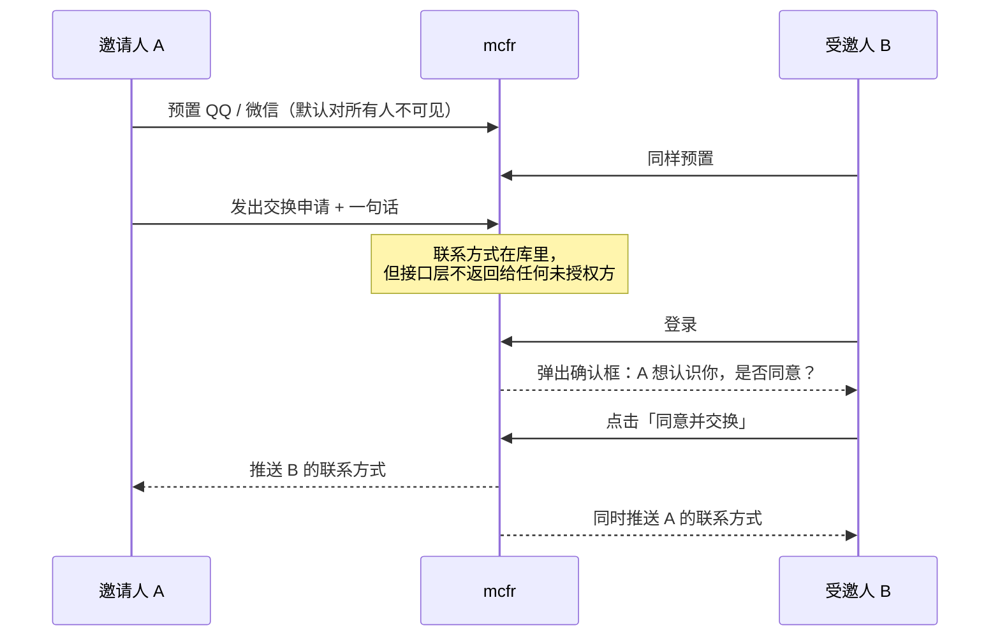
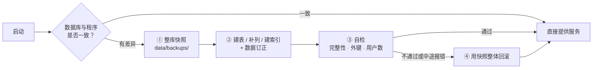

# mcfr

面向中小学生《我的世界》玩家的**安全、纯净**交友平台 —— 根据开题报告 MVP 范围实现的可运行版本。

> 核心问题：中小学生 MC 玩家社交范围小、缺少安全纯粹的交流环境。
> mcfr 专注解决两件事：**找到合得来的同好**，以及**在双方都同意的前提下互换联系方式**。

---

## 一、两条核心设计

### 1. 联系方式受控交换（站内不做聊天）

交流发生在玩家自己熟悉的社交软件里，但「谁可以拿到我的联系方式」完全由本人逐条决定。



三条硬性规则：

1. **默认不可见** —— 联系方式字段在接口层就不返回给他人（推荐列表、资料页、申请列表都不含）
2. **逐条授权** —— 不是加了好友就自动可见，每次交换都要本人点一次「同意」
3. **可随时收回** —— 点「解除」后对方的联系方式立刻从列表中消失

### 2. 图片人机验证，不需要邮箱

| 方式 | 说明 |
| --- | --- |
| **用户名 + 密码** | 注册时设置的密码 |
| **邮箱 + 密码** | 同一个密码，填过邮箱的也能用邮箱登 |
| **管理员重置** | 忘了密码就找管理员，他点一下就能给你一个临时密码 |
| **自助改密** | 「我的 → 账号 → 修改密码」，改完所有设备重新登录 |

**注册不需要邮箱。** 填邮箱也可以，但它只是一个联系方式，不会被验证、
也不会收到任何邮件。手机号全程不收集。

> v0.21 起取消了整条邮件链路（原来注册要邮箱验证码、登录可以免密、找回密码靠邮件）。
> 现在注册与登录（含管理员登录）都只卡一道**图片验证码**：
> 图是本站用纯 Python 现画的（`backend/captcha.py`），不接 reCAPTCHA 这类外部服务。
> 好处有三个：不花一分钱、不需要任何配置、
> 以及**不会把学生的 IP 交给第三方**。

---

## 二、快速开始

```bash
# 1. 安装依赖（只需一次）
python -m pip install -r requirements.txt

# 2. 启动服务（首次会自动建库，数据库里是空的）
python run.py

# 3. 浏览器打开
#    http://127.0.0.1:8000
```

### 人机验证：零配置，开箱即用

**不需要配置任何东西。** 验证码图是后端用纯 Python 现画的
（`backend/captcha.py`，没有 Pillow，也没有外链任何验证码服务）：

```
4 位字符 · 31 个易辨认字符（去掉了 0/O/1/I/L）· 92 万种组合
       ↓
内置点阵字库画出笔画 → 叠 3 条正弦干扰线 → 撒噪点
       ↓
用 zlib + struct 手写 PNG 编码 → base64 直接塞进 JSON 返回
```

为什么不用 reCAPTCHA / hCaptcha 这类现成方案：

1. 项目的硬约束是**零第三方依赖 + 不用外部 CDN**，外链脚本会被 CSP 的
   `script-src 'self'` 直接拦掉；
2. 更要紧的是**隐私** —— 挂一个第三方验证码，等于用户每登录一次就把 IP
   交给那家公司。本站用户以未成年人为主，这一点不能妥协。

自己画则完全闭环：图片在服务器本地算出来，一个字节都不出去。

**防护强度**（都写在 `backend/captcha.py` 顶部的常量里，可直接改）：

| 项 | 值 | 作用 |
| --- | --- | --- |
| 有效期 | 5 分钟 | 够填完，不够被慢慢暴力试 |
| 单张最多试 | 5 次 | 超了作废，必须换新的 |
| 单 IP 每小时最多领 | 120 张 | **这一条同时就是登录尝试速率的上限** |

> 最后一条值得说明：因为每次登录都必须先领一张图，所以领图限流 = 撞库限流。
> 120 是按「学校机房 / 宿舍共用同一个出口 IP，一节课 30 人同时登」估的 ——
> 既不会误伤，又让脚本每小时最多只能试 120 次密码。

**忘记密码怎么办**：没有邮件就没有自助找回渠道了，这是取消邮件必然要付的代价。
界面上保留一个「忘记密码？」按钮，点了会告诉你去找管理员；
管理员在后台用户列表里点「重置密码」，会生成一个临时密码（已去掉易混字符，
方便当面念给对方），用户登录后可以自己在「我的」页面改成新的。

---

### 第一次使用

数据库是空的，**没有任何内置账号** —— 请直接自己注册一个。

注册不需要邮箱，只要填用户名、昵称、密码，再过一道人机验证就行了。

想彻底重来（清空所有账号）时，停掉服务、删掉 `data/mcfr.db` 再启动即可。

> **想让页面立刻有人可看**（演示 / 录屏 / 答辩）：`python seed_demo.py --yes`
> 会灌 12 位演示玩家。它们是假的，上线前一定 `python seed_demo.py --purge --yes`
> 删掉 —— 详见下面「演示数据」一节。

### 我的形象（头像 / 皮肤）

在「我的」页面可以上传自己的形象：

- **上传 Minecraft 皮肤**（64×64 或 64×32 的 PNG），页面会给出一个 **3D 预览**：
  **按住鼠标左右拖动即可旋转**，松手带惯性，双击回到正面；
  一直不动时它会自己慢慢转（开启「减弱动态效果」的系统设置则不自转）。
- **上传自定义头像**（浏览器会先缩放成 256×256 的 PNG 再上传）。
- 头像按三级优先级自动选择，不需要你额外设置：
  1. 上传过的自定义头像图片
  2. 上传过的皮肤 —— 自动取皮肤里的头部
  3. 都没有 → 根据用户名生成的像素脸

3D 预览是**自己用 Canvas 2D 写的**（`frontend/js/skinview.js`），
没有引 three.js 之类的库，也不依赖 CDN。原理：正交投影下每个面仍然是
平行四边形，用 `ctx.setTransform` 的仿射矩阵把皮肤贴图贴上去，
再按面朝向剔除背面、按深度排序（画家算法）。

上传的实现刻意**不增加任何依赖**：只需要 `fastapi` 和 `uvicorn`。
- 浏览器端先把头像缩放到 256×256，服务端就不用图像库（无需 Pillow）；
- 上传走原始 PNG 请求体，不用 multipart 表单（无需 python-multipart）。

服务端仍然会严格校验：必须是真的 PNG、尺寸符合要求、字节数有上限，
文件名一律由服务端生成 32 位随机十六进制，读取时只认这个格式 ——
路径穿越（`../../.env` 之类）会被直接挡掉。

图片文件存放在 `data/uploads/`，换头像时会顺手删掉旧文件。

### 常用参数

```bash
python run.py --port 9000              # 换端口
python run.py --reload                 # 开发模式，改代码自动重启

python run.py --check                  # 看数据库版本 / 用户数 / 健康自检 / 备份列表
python run.py --upgrade                # 只跑一次升级（会自动先备份）
python run.py --backup                 # 现在手工备份一份
python run.py --list-backups           # 列出所有备份
python run.py --import-db 路径.db      # 把一个数据库文件导入进来（会先备份当前数据）
```

接口文档：<http://127.0.0.1:8000/api/docs>

---

## 三、功能清单

### 账号与登录
- 注册（人机验证 + 密码 + 用户名 + 资料）、登录、退出、**注销并删除全部数据**
- 每次注册与登录（含管理员登录）都要过一道**图片人机验证**
- 忘记密码 → 找管理员重置（无邮箱找回流程）；登录后可以自己改密码
- 个人资料：游戏昵称、版本（Java / 基岩 / 双版本）、年龄区间、地区、喜欢的玩法、常在线时段、想找的伙伴、简介
- **联系方式**：QQ、微信号、其他平台账号、给对方的备注
- 隐私开关：接收联系方式交换申请 / 对外显示在线状态
- **最小化收集**：邮箱选填且不验证，不收集真实姓名、学校、住址、手机号

### 发现同好（可解释的匹配）
- 推荐列表自动排除：已交换、已有待处理申请、已屏蔽、已跳过的人
- 匹配度 0–100 分，由共同玩法、共同诉求、共同在线时段、版本、年龄区间、地区、活跃度加权得出
- **每张卡片都会写出「为什么推荐 TA」**
- 卡片标注「已备联系方式」，方便判断值不值得发申请

### 文案与「看起来在运营」（v0.37）

这一版没加功能，改的全是「像不像真的有人在这用」。

**导语去掉了机器味。** 原来那句「按你们喜欢的玩法、游戏版本和上线时间算出
『合得来指数』」—— 它把一件很朴素的事说成了一套算法，读起来像产品需求文档。
现在写的是它真正在做的事：

> 根据你的游戏版本、常玩的玩法与作息，替你排一份今晚能一起开局的名单。

**没写简介的人不再复读同一句。** 卡片上原来一律显示「这位玩家还没有写简介。」，
十张卡里出现十次，一眼就是空站。现在的三层降级：

| 情况 | 显示什么 |
| --- | --- |
| 写了简介 | 原样显示 |
| 没写，但填了玩法 / 作息 | 用 TA 自己的资料拼：`常玩 生存、红石。` + `周末白天在线。` |
| 什么都没有 | 三句按 `id % 3` 轮换，**不随机**（随机会让句子在重绘时跳） |

> **为什么不直接编一句「找个红石大佬带我」？**
> 那是替用户发言。在这个站上（大多是未成年人），把一句没说过的话挂在他名下，
> 比显示「还没写」严重得多。用他自己填过的字段拼出来的句子，每一句都是真的 ——
> 而且天然各不相同，效果比编造更好。

**卡片有了纸面颗粒。** `--noise` 是一段内联 SVG `feTurbulence`（5% 左右），
浅色主题用深色颗粒、深色主题反过来（黑底上的黑点等于没有）。
它只做一件事：让纯白卡片不那么「塑料」。

**侧栏底部那盏灯是真的。** 它显示 `/api/health` 的往返毫秒数和 300 秒窗口内
的在线人数，每 90 秒测一次，切到后台就停。**没有写死「在线」** ——
写死的灯最省事，但后端真挂了它照样亮着，整页的「活数据」就一起不可信了。
灯是呼吸的（2.8 秒一个来回），不是闪的。

### 演示数据：`seed_demo.py`

刚装好的站点，「发现同好」是一张空网格 —— 而它正是访客登录后第一眼看到的页面。
所以有一个脚本灌 12 位演示玩家：

```bash
python seed_demo.py                 # 只打印计划，不写库
python seed_demo.py --yes           # 写进去
python seed_demo.py --touch --yes   # 让它们重新「上线」（在线是按 last_seen 算的，会过期）
python seed_demo.py --purge --yes   # 删干净
```

三个细节是为了「像真的」：

- **口令随机且不打印** —— 演示数据只负责「看起来有人」，不负责「能登进去」
- **`last_seen` 错开** —— 只有几位刚在线，其余几小时到几天前。全在线反而假
- **积分错开** —— 大部分人 Lv.2–4，只有一两个更高；一个刚起步的站不该满地是老人

> ⚠️ **上线前务必 `--purge`。** 一个真的在运营的站不该有 12 个假玩家，
> 而且它们占着推荐名额，会把真人挤下去。

### 圈子（v0.34）

找到同好之外的第二条路：**不用等算法发牌，自己挑一个主题进去。**

侧栏的「圈子」里有两档：

| 档 | 里面是什么 |
| --- | --- |
| **我的圈子** | 我加入过的全部圈子。点进去看里面的帖子，或者点「删除」退出 |
| **发现圈子** | 站内所有还在的圈子，按人数从多到少排。可以按名字或介绍搜 |

「建一个圈子」填四样东西：圈子名（2–20 字、全站唯一、不分大小写）、
一句话介绍、主题（生存 / 建筑 / 红石 / 模组 / 小游戏 / 联机 / 聊天 / 综合）、
以及选填的详细说明。建好之后创建者就是**圈主**，并且自动成为第一个成员。

**圈子里的帖子只有圈子的成员看得见。** 这是圈子和「帖子」那个广场唯一、
也是全部的区别：

- 帖子广场是全站公开的，谁都能看、谁都能写；
- 圈子是一间房间，推门进去才看得到里面的话。

圈外人打开一个圈子的地址，能看到名字、介绍、人数和成员的方块头像，
但帖子列表那里只有一句「加入之后才能看到圈子里的帖子」。
如果他知道某篇圈子帖的编号直接访问，会拿到 **404** —— 和「帖子已被下架」
同一个口径，不告诉他「这里确实有一篇你看不了的东西」。

这条边界是一整套，不是只有「列表里不显示」：

| 入口 | 圈外人 |
| --- | --- |
| 帖子详情 | 404 |
| 评论列表 / 发评论 | 404 |
| 点赞 | 404 |
| 转发 | **圈内帖一律不能转发**（422） |

> 转发这一条是刻意封死的：转发会连标题一起出现在对方的通知里，
> 而标题往往就是内容本身。要聊圈子里的事，就进圈子说。
> 判断都收在 `posts.assert_visible()` 和 `posts.share()` 两处，
> 不在路由层各写一遍 —— 十几个入口里漏一个，就是一次内容泄露。

**在圈子里发帖用的就是原来那个发帖功能**：同一个富文本编辑器、同一套
配图 / 附件 / 制作人员 / 点赞 / 评论，只是编辑器顶上多一行
「发到圈子：红石研究所（只有这个圈子的成员看得到）」，
而且详情页上不会有「转发」那颗按钮。
写完之后也回到圈子里看，而不是跳去广场。

退出圈子（界面上那句「删除」）分三种情况：

| 谁退出 | 会发生什么 |
| --- | --- |
| 普通成员 | 自己那一行删掉，别的不变。他写过的帖子留在圈子里 |
| 圈主，圈子里还有别人 | **移交给最早加入的那一位**，不会出现没人管得动的孤儿圈子 |
| 圈主，圈子里只剩他 | 圈子**解散**，里面的帖子一起软删（作者仍能在「我发的」里看到，标着「已删除」） |

> 界面上那句「删除」其实是**退出**，不是删掉别人的东西 ——
> 确认框里会把三种后果说清楚，圈主那句还会特别提醒「圈子会一起解散」。
> 之所以按钮上写「删除」，是因为需求里就是这么描述的：从我的列表里删掉它。

还有一些限制，都是防刷、不是防人：一个人最多同时加入 **30** 个圈子，
一天最多创建 **3** 个。圈子名撞车（忽略大小写）会被拒绝，
内容会过一遍和帖子相同的那套安全词库。

### 联系方式交换
- 申请时可附一句想说的话
- **受邀人登录后自动弹出确认框**，逐条处理（可「稍后再处理」）
- 同意后立刻展示对方联系方式 + 一键复制，同时把自己的发给对方
- 若对方已先申请过我，我发申请时会直接完成互换
- 交换成功后可随时「解除」

### 成就与激励
**28 项成就**，分五类：

| 类别 | 例子 |
| --- | --- |
| 填好资料 | 初次启程、自我介绍、全能玩家、**有备而来**、开诚布公、体贴的人 |
| 装粉形象 | 独一无二（自定义头像）、皮肤设计师 |
| 认识伙伴 | 破冰问候、初次联络、五人小队、联络大师、伙伴遍天下、热心邻居、宁缺毋滥 |
| 到处看看 | 探索者、见多识广、人气之星、社区明星 |
| 登录节律 | 深夜建筑师、早起的鸟、周末玩家、**三日之约**、一周不缺席、月度常客 |
| 社区 | 安全卫士、有话直说、双版本通吃 |

解锁即得积分（共 760 分），10 个等级（新来的方块 → 传奇同好）。
满级需要 720 分，留了 40 分容错 —— 不必把最后一条献牲旮旯的成就也啮下来。

> **故意没有「夜猫子（深夜登录 N 次）」这类可重复刷的成就。**
> 本站面向中小学生，一个鼓励“今晚再熬一次”的徽章是反向激励。
> 深夜登录只保留一条一次性的「深夜建筑师」，撞见就撞见了，不值得追。

### 屏蔽与举报
一键屏蔽（同时解除交换关系、清掉双方待处理申请），举报 6 类原因进入后台待办队列。

### 意见反馈
主界面左下角有一枚常驻的「反馈」浮标，点开就能提：

- 分五类：功能建议 / 问题反馈 / 内容举报 / 安全隐私 / 其它
- **不登录也能提交** —— 登录不上来的人、还没注册的人，恰好是最需要反馈的
- 留个联系方式的话，管理员处理完可以回访
- 限流：同一 IP 每小时 5 条、每天 20 条；登录用户再按账号限一次

### 界面与主题
- 设计语言是现代体素主义：云白底 + 草方块绿，方块 / 像素 / 网格都只借「形」不借「色」
- **深浅两套配色，默认跟随系统**；右上角可手动切四态
  （跟随系统 / 浅色 / 深色 / **跟随时间**），选择记在本机，下次打开还是它
- **跟随时间**（v0.35）：白天浅色、夜里深色；而且整页的光会跟着钟表走 ——
  早雾、上午、中午、下午、黄昏、蓝调各有各的天色，夜里还会随夜深一点点沉下去。
  详细说明见第八节
- 键盘可达、`prefers-reduced-motion` 有降级、对比度按 WCAG 校过

### 管理后台（`/admin`）
- 入口在站点根路径下的 `/admin`，**需要管理员用户名 + 密码**；未登录时页面源码里没有任何运营数据
- **两级账号**：超级管理员（`adminzmq`）拥有一切；普通管理员由超管添加，
  固定能用四个基础页签，其余模块逐项授权（看不到 / 只能看 / 能改）
- **人口卫**：图片验证码在服务器本地生成，**不接任何外部验证码服务**
- **数据概览**：用户、交换关系、举报、人机验证量等 13 项指标
- **举报处理**：查看举报详情 → 标记已处理 / 重新打开 / 直接暂停被举报账号
- **用户管理**：按用户名、昵称或邮箱搜索，查看账号状态，暂停 / 恢复账号，**重置密码**
- **安全记录**：谁在领验证码、谁一直在错、哪些 IP 可疑
- **意见反馈**：看用户提的问题，写回复、标记已处理、删除
- 暂停账号会同时清空该用户全部登录会话，立即生效
- 管理员令牌与普通用户令牌**完全隔离**，登录失败次数受限（15 分钟 / 5 次）
- 详细说明见第九节

### 内容安全
`backend/moderation.py`：

1. **导流 / 诈骗话术**：免费送皮肤、代充、兼职刷单、扫码领取……（命中即阻断）
2. **手机号防护**：唯一会被阻断的联系方式类型，因为涉及实名与线下联系
3. **QQ / 微信不拦截** —— 引导填到专用字段，由交换机制管控

词库可外置到 `data/blocked_keywords.txt`（一行一词，`#` 开头为注释）。

---

## 四、安全设计

### 口令与登录

| 项目 | 做法 |
| --- | --- |
| 存储 | PBKDF2-HMAC-SHA256，20 万次迭代 + 16 字节随机盐。**任何人（包括管理员和拿到数据库文件的人）都看不到原文** |
| 比对 | 常数时间（`hmac.compare_digest`），不因前缀匹配而提前返回 |
| 账号枚举 | 账号不存在时也照常跑一次哈希比对。否则「不存在」1 毫秒返回，而「口令错误」要等 20 万次迭代 —— 靠响应时间就能把站里的账号一个个试出来 |
| 登录失败 | 后台按 IP 限制：15 分钟内 5 次 |
| 会话 | 令牌存在数据库里，可即时吊销；登出 / 封禁 / 改密码 / 停用管理员都会立刻踢下线 |

### 人机验证（图片验证码）

后端用纯标准库画出来的，没有 Pillow，也没有外链任何验证码服务（见 `backend/captcha.py`）。

| 项目 | 取值 | 说明 |
| --- | --- | --- |
| 字符表 | 31 个字符，去掉了 `0 O 1 I L` | 小字号点阵下这几个分不清，惩罚的只是真人 |
| 位数 | 4 位 = 92 万种组合 | 配上次数限制完全够用 |
| 生成 | `secrets.choice` | 密码学安全随机源，不是 `random` |
| 存储 | HMAC-SHA256(凭据 id + 答案, 服务端密钥) | **不存明文**；id 参与哈希，防止一个 id 的哈希表被拿去撞另一个 |
| 凭据 id | `secrets.token_urlsafe(18)` | 用随机串而不是自增整数 —— 自增就能被枚举 |
| 有效期 | 5 分钟 | 过期需重点图片 |
| 单张最多错 | 5 次 | 超了直接作废，必须换新的 |
| 单次使用 | 通过后立刻标记 `consumed_at` | 防重放（已实测：同一张图第二次使用被拒） |
| 领取限流 | 同 IP 每小时 120 张 | **这一条同时就是登录尝试速率的上限** |
| 用途隔离 | `login` / `register` / `admin` 不能串用 | 拿前台领的图来登后台会被挡下来 |
| 大小写 | 不区分 | 把 `l` 认成大写的 `I` 是常见笔误，不是攻击 |
| 密钥 | 首次启动生成 `data/server_secret.key` 并复用 | **重启服务不会让用户手里那张图失效** |

> **为什么答案不落明文也不回传**：接口只回图片，明文答案只存在于
> `captcha.issue()` 的局部变量里。连测试脚本想走通正常流程，
> 都只能拿着库里的哈希把 92 万种组合撞一遍（见 `_e2e_auth.py` 的 `solve()`）。
>
> **为什么先卡验证码再查账号**：如果先查库，`captcha` 那一步就要排在后面，
> 「账号存不存在」会从响应时间上泄出来（存在时要多跑一次 PBKDF2）。
> 先卡验证码，两种情冀就在同一步被挡下，时间差就没了。

### 旧版邮箱验证码（v0.21 起已移除）

早期版本注册要邮箱验证码、登录可以免密、找回密码靠邮件。这段已经整个删掉了，
原因很简单：**它把「能不能注册」系在一个外部服务上**。
实际跑起来遇到过「SMTP 535 认证失败」这类只在发信那一刻才暴露的问题，
用户看到的是「收不到验证码」，而页面还显示「已发送」。


### 来源 IP 与限流

**限流要有意义，前提是「来源 IP」本身不可伪造。**
而 `X-Forwarded-For` 是客户端可以随便在请求头里写的东西。

早先代码直接采信了它，后果是：

- **后台登录失败限制形同虚设** —— 每次请求换一个伪造 IP，就能无限次试管理员口令；
- 人机验证的领取限制同样失守，脚本可以无限取图去离线破解；
- 后台「安全记录」里显示的来源 IP 全是假的，出事后查不到人。

现在来源 IP 只有一个出处：`backend/client_ip.py`。

| 场景 | 行为 |
| --- | --- |
| 默认（直接跑 uvicorn，或没配代理） | 只认 TCP 连接的对端地址，**完全不看** `X-Forwarded-For` |
| 配了 `MCFR_TRUSTED_PROXIES` | 才去读该头，并且**从右往左**取第一个不可信地址（最右边那跳是代理写的，伪造不了） |

配套地，`run.py` 里显式关掉了 uvicorn 自己的 `proxy_headers`。它默认会拿
`X-Forwarded-For` 去替换 `request.client.host`，**是在应用代码之前生效的** ——
只知道改应用层的话，改完测起来还是一样被绕过（这个坑是实测踩出来的）。

> 判断只留一处，才不会有「两层互相打架」这种事。

### 会话、响应头与上传

- 管理员令牌存在独立的 `admin_sessions` 表，与普通用户会话完全隔离，
  某个用户的令牌泄露也拿不到后台权限
- 令牌有效期：普通用户 14 天，管理员 8 小时；过期记录会被定期清理，表不会无限增长
- 所有响应带 `Content-Security-Policy`（`script-src 'self'`，**不允许内联脚本**）、
  `X-Content-Type-Options: nosniff`、`X-Frame-Options: DENY`、`Referrer-Policy`
- 跨域默认**关闭**；确实需要时用 `MCFR_ALLOWED_ORIGINS` 显式列出
- `/api/docs` 默认关闭（它相当于一份现成的接口清单），用 `MCFR_ENABLE_DOCS=1` 打开
- 上传只收 PNG（校验文件头与 IHDR 块），头像 ≤ 512×512 / 1MB、
  皮肤必须是 64×64 或 64×32 / 512KB；落盘文件名由服务端生成，
  配合正则白名单挡掉路径穿越

### 前端渲染

用户提交的所有内容在插入页面前都过一遍 `esc()`（转义 `& < > " '`），
**没有任何一处把用户数据直接拼进 `innerHTML`**。昵称、简介、地区、
打招呼的话、举报详情、意见反馈的内容与联系方式，全部走转义。

这是最容易被忽略、后果又最直接的一类问题：反馈功能刻意不做关键词过滤，
也就是说任何字符串都能存进库里 —— 只要有一处忘了转义，就是管理员一打开后台
就被执行脚本的存储型 XSS。

CSP 里的 `script-src 'self'` 是这条防线的第二层：即使哪天真漏了一处，
注入进来的 `<script>` 和 `onerror=` 也跑不起来。

### 已知未做

- 没有双因素认证
- 上传的图片不做内容审核（靠举报 + 人工处理）


---

## 五、技术栈

| 层 | 选型 | 说明 |
| --- | --- | --- |
| 后端 | Python 3.13 + FastAPI | 类型校验由 Pydantic v2 完成 |
| 数据库 | SQLite（WAL 模式） | 零配置；后续可平滑迁移 MySQL / PostgreSQL |
| 人机验证 | 纯 Python 现画的 PNG | 不要 Pillow、不接外部服务，连 zlib 和 struct 都是标准库 |
| 鉴权 | PBKDF2-HMAC-SHA256 + Bearer Token | 仅用标准库，令牌可即时吊销 |
| 前端 | 原生 HTML / CSS / JS | **无构建步骤**，不依赖 npm 与 CDN |

---

## 六、目录结构

```
项目_我的世界论坛与交友/
├── 开题报告.txt
├── README.md
├── requirements.txt
├── .env.example                # 配置模板（会提交到 git）
├── .env                        # 你的本地配置（不会提交）
├── run.py                      # 一键启动 / 升级 / 备份 / 导入的入口
├── seed_demo.py                # 灌 12 位演示玩家（--purge 删干净，上线前必跑）
├── backend/
│   ├── main.py                 # FastAPI 入口、路由装配、统一错误处理
│   ├── config.py               # .env 加载与配置自检
│   ├── database.py             # 连接管理、建表 SQL 与迁移步骤登记表
│   ├── admins.py               # 管理员账号体系：两级账号、权限判定、口令校验
│   ├── client_ip.py            # 来源 IP 的取法（默认不信任 X-Forwarded-For）
│   ├── upgrade.py              # 升级引擎：备份、迁移、自检、回滚、导入导出
│   ├── security.py             # 口令哈希、令牌与服务端签名
│   ├── captcha.py              # 图片验证码：点阵字库 + 干扰线 + 手写 PNG 编码
│   ├── moderation.py           # 内容安全规则过滤
│   ├── schemas.py              # 请求/响应模型与选项字典
│   ├── matching.py             # 匹配度算法 + 资料序列化（含联系方式开关）
│   ├── posts.py                # 帖子：发布、点赞、评论、转发、通知、内容校验
│   ├── circles.py              # 圈子：建 / 加入 / 退出 / 列表，以及「谁能看见圈子帖」
│   ├── achievements.py         # 成就定义与解锁判定（每条自带 target + progress）
│   ├── deps.py                 # 登录态依赖
│   ├── media.py                # 上传的皮肤 / 头像（校验与落盘，零额外依赖）
│   ├── modrinth.py             # Modrinth API 的最小客户端（纯标准库）
│   ├── mirror.py               # 模组镜像：索引落库、版本筛选、后台任务、文件下载、每日自动同步
│   └── routers/
│       ├── auth.py             # 注册 / 登录 / 改密 / 注销
│       ├── captcha.py          # 领一张人机验证图
│       ├── users.py            # 资料、隐私、联系方式、成就墙、他人主页
│       ├── media.py            # 皮肤 / 头像的上传与图片读取
│       ├── discover.py         # 推荐与跳过
│       ├── circles.py          # 圈子（用户侧）
│       ├── mirror.py           # 模组镜像（用户侧 + 后台）
│       ├── feedback.py         # 意见反馈（用户侧提交）
│       └── contacts.py         # 联系方式交换、屏蔽、举报
├── frontend/
│   ├── index.html              # 主站单页
│   ├── admin.html              # 管理后台页面（访问 /admin）
│   ├── css/
│   │   ├── aether.css          # 设计系统层（令牌与基础组件）
│   │   ├── app.css             # 应用层（各页面布局）
│   │   ├── admin.css           # 管理后台专用样式
│   │   └── minecraft.css       # MC 元素层（图标、经验条、加载方块、草方块按钮）
│   ├── fonts/
│   │   ├── press-start-2p-latin.woff2   # 像素字体（仅 latin 子集，12KB）
│   │   └── README.txt          # 字体来源与授权（SIL OFL 1.1）
│   └── js/
│       ├── theme-boot.js       # 防闪烁：样式生效前定下 data-theme（必须同步加载）
│       ├── theme.js            # 四态主题切换（跟随系统 / 浅色 / 深色 / 跟随时间）
│       ├── daylight.js         # 跟随时间的天光：14 个关键帧 + 太阳轨迹 + 夜色深度
│       ├── mcicons.js          # MC 抽象图标：等距体素图标 + 侧栏线条图标
│       ├── api.js              # 接口封装
│       ├── app.js              # 主站状态、渲染与事件委托
│       ├── admin.js            # 管理后台逻辑
│       ├── skinview.js         # 皮肤的纯 Canvas 2D 立体预览
│       └── effects.js          # 点击涟漪 / 方块碎屑 + 背景离子流动
└── data/
    ├── mcfr.db                 # 运行时自动生成（用户数据都在这里）
    └── backups/                # 升级 / 手工备份的快照，直接复制走就能换机器
```

---

## 七、主要接口

| 方法 | 路径 | 说明 |
| --- | --- | --- |
| GET | `/api/captcha` | 领一张图片验证码（返回 base64 图 + 凭据 id） |
| POST | `/api/auth/register` | 注册（需人机验证） |
| POST | `/api/auth/login` | 密码登录（用户名或邮箱，需人机验证） |
| POST | `/api/auth/password` | 修改自己的密码（需登录，改完所有会话失效） |
| DELETE | `/api/auth/account` | 注销账号 |
| GET | `/api/users/me/overview` | 个人中心汇总（资料 + 邮箱 + 联系方式 + 等级 + 成就） |
| PUT | `/api/users/me` | 更新资料与联系方式 |
| PATCH | `/api/users/me/privacy` | 更新隐私设置 |
| GET | `/api/users/{id}` | 他人主页（联系方式仅在已建立交换关系时返回） |
| GET | `/api/discover` | 推荐同好列表 |
| GET/DELETE | `/api/connections` | 已交换的同好 / 解除交换 |
| GET | `/api/contact-requests/pending` | 待我处理的申请（登录弹窗用） |
| POST | `/api/contact-requests/{target_id}` | 发起交换申请 |
| POST | `/api/contact-requests/{id}/accept` | 同意并交换 |
| GET/POST | `/api/blocks`、`/api/reports` | 屏蔽与举报 |
| POST | `/api/feedback` | 提交意见反馈（可匿名，带限流） |
| GET | `/api/feedback/mine` | 我提交过的反馈 |
| GET | `/api/circles` | 圈子列表（`scope=mine` 我加入的 / `all` 全部，可带 `q` 搜索） |
| POST | `/api/circles` | 创建圈子（创建者自动成为圈主并加入） |
| GET | `/api/circles/{id}` | 圈子详情（非成员也能看，但看不到帖子） |
| POST | `/api/circles/{id}/join` | 加入圈子（重复调用是幂等的） |
| POST | `/api/circles/{id}/leave` | 退出圈子（返回是否解散、是否移交给了谁） |
| GET | `/api/circles/{id}/posts` | 圈子里的帖子（**仅成员**，非成员 403） |
| GET | `/api/circles/{id}/members` | 圈子成员（圈主排第一） |
| POST | `/api/admin/login` | 管理员登录（用户名 + 密码） |
| GET | `/api/admin/me` | 当前管理员是谁、能看哪些页签 |
| GET/POST | `/api/admin/admins` | 管理员列表 / 添加普通管理员（仅超管） |
| PATCH/DELETE | `/api/admin/admins/{id}` | 改资料·密码·状态·权限 / 删除（仅超管） |
| GET/PATCH/DELETE | `/api/admin/feedback` | 反馈列表 / 处理回复 / 删除（需 feedback 权限） |
| POST | `/api/admin/login` | 管理员登录（密码） |
| GET | `/api/admin/overview` | 后台数据概览 |
| GET | `/api/admin/reports` | 举报列表 |
| POST | `/api/admin/reports/{id}/resolve` | 标记举报已处理 |
| GET | `/api/admin/users` | 用户列表（支持搜索） |
| POST | `/api/admin/users/{id}/status` | 暂停 / 恢复用户 |
| GET | `/api/admin/system` | 版本、数据库信息、备份列表、升级历史 |
| POST | `/api/admin/system/backup` | 立即备份数据库 |
| GET | `/api/admin/system/export` | 下载当前数据库（在线快照，含最新写入） |
| GET | `/api/admin/system/backup/{name}` | 下载某一份备份 |
| POST | `/api/admin/system/backup/{name}/restore` | 用某一份备份还原 |
| DELETE | `/api/admin/system/backup/{name}` | 删除某一份备份 |
| POST | `/api/admin/system/upgrade` | 立即执行待升级项 |
| POST | `/api/admin/system/import` | 导入 `.db` 文件（请求体就是文件本身，与图片上传一样避开 multipart） |

---

## 八、界面设计

设计语言是**现代体素主义**：以现代网页的秩序、留白、可读性为骨架，
把《我的世界》的方块、像素、生物群系、合成逻辑当作抽象语义来用 ——
而不是把游戏画面搬进网页。完整规范在根目录的 `网站界面重构设计.txt`。

### 颜色语义（固定，不要按个人喜好改）

| 颜色 | 值 | 管什么 |
| --- | --- | --- |
| 草方块绿 | `#6BA84F` | 品牌、生长、社区、积极操作 |
| 钻石青 | `#26C6DA` | 交互、探索、链接、焦点 |
| 金锭黄 | `#F9A825` | 成就、奖励、高光 |
| 红石红 | `#C62828` | 错误、危险、删除 |
| 下界紫 | `#7E57C2` | 稀有、特殊、限定 |
| 深板岩灰 | `#1E2328` / `#6B7280` | 文本与结构 |
| 云白 | `#F7F9F8` | 安静表面与留白 |

用量比例大致 **60% 中性色 : 30% 主色 : 10% 强调/语义色**。

落在代码里就是 `aether.css` 顶部 `:root` 的那组令牌：`--grass-*`（主色）、
`--diamond` / `--gold` / `--redstone` / `--nether`（语义色）、
`--void` / `--ink` / `--panel`（云白体系的表面）、`--tint-1..3`（中性叠加）。

### 深浅主题（跟随系统 / 浅色 / 深色 / 跟随时间）

界面有两套配色，由 `<html data-theme="light|dark">` 切换，**默认跟随系统**。
右上角有一枚**四态**按钮循环切换，偏好存在 `localStorage` 的 `mcfr.theme`；
登录页和管理后台的登录闸门也各有一枚（`--float` 版本，固定在右上角）。

四态而不是一个开关，是因为「只给两态」就永远回不到跟随系统了 ——
用户在系统里改了设置，站点却还停在他很久以前手动选的那一档。

| 档 | 谁来定浅色还是深色 |
| --- | --- |
| 跟随系统 | `prefers-color-scheme` |
| 浅色 / 深色 | 用户自己，钉死 |
| **跟随时间** | 现在几点：6:00–18:00 浅色，其余深色 |

**切换只换「结构性」颜色，品牌色不动。** 这条是深色主题的核心约束：

| | 换不换 | 为什么 |
| --- | --- | --- |
| 表面 / 文本 / 描边 / 叠加 / 阴影 | ✅ 换 | 它们的意义就是「相对于底色的层次」，底色变了就得跟着变 |
| 草方块绿 `--grass-*` | ❌ 不换 | 它就是「mcfr 是绿的」这件事本身 |
| `--diamond` / `--gold` / `--nether` | 色相不换，明度微调 | 语义不变，但深底上要提亮才读得清 |
| `--redstone` | 色相不换，明度提亮 | `#c62828` 在云白上有 4.6:1，在深板岩灰上只剩 2.2:1 |

实现上有三处值得注意：

1. **`data-theme` 上只放解析后的结果**（`light` / `dark`），
   「跟随系统」这个**偏好**本身只存在 JS 里。于是 CSS 只需要一套
   `html[data-theme="dark"]` 覆盖块，不必再写一份 `@media (prefers-color-scheme)` 副本 ——
   两份真值放在两个地方，迟早会不同步，而且是静默的那种。
2. **首屏不闪**：`<head>` 里有一段同步内联脚本，在任何样式生效之前就把
   `data-theme` 写好了。只靠 `theme.js` 会晚一步 —— 深色系统的用户会先被闪一下白，
   再整页刷地变黑。那段脚本的判断逻辑必须和 `theme.js` 里的 `resolve()` 保持一致。
3. **`color-scheme` 跟着走**：原生滚动条、`<select>` 展开的选项列表、日期选择器、
   自动填充的底色 —— 这些由浏览器自己绘制、CSS 管不到，但会跟着 `color-scheme` 变。
   不设的话，深色页面里会弹出一块刺眼的白。

| 文件 | 负责什么 |
| --- | --- |
| `frontend/js/theme.js` | 四态状态机、按钮渲染、监听系统变化、读写 `localStorage`、换色时的一下淡变 |
| `frontend/js/daylight.js` | 「跟随时间」那条时间轴：现在几点 → 天光与光影（纯计算；只写 CSS 变量，从不重建渐变） |
| `frontend/js/theme-boot.js` | 首屏防闪烁，`<head>` 里同步跑，包含「跟随时间」的白天/黑夜判断 |
| `frontend/css/aether.css` | `:root` 里的模式令牌 + 文件末尾的 `html[data-theme="dark"]` 覆盖块 + 天光两层与四层光影 |

> **延伸样式时不要再用裸的 `rgba(255,255,255,α)` 或 `rgba(30,35,40,α)`。**
> 那是「假定背景一定是白的」的写法：切到深色后，前者会糊成一片白雾，
> 后者会彻底消失。两者都不报错、不告警，只是那个效果静静地没有了 ——
> 这是这套主题里最容易再次踩进去的坑。要在两种主题下都成立，
> 就用 `--hl-1` / `--shade-lo` / `--tint-*` / `--line*` 这一组。
>
> 只有少数几处**故意**写死了白色，都在原地注明了理由：它们照的是自己脚下那块
> 亮色（头像方块、开关圆钮、经验条亮头、草方块按钮），不是页面背景。

深色主题的对比度是按 WCAG 重算过的，不是把浅色的值取反：
正文 13.2:1、次级文本 9.1:1、`--muted` 5.6:1、绿底上的深字 5.7:1，
连红石红都从浅色主题的 5.6:1 提到了 4.5:1（正好够 AA）。

### 跟随时间：天光与光影（v0.35 → v0.36）

选到「跟随时间」之后，站点不只是「到点切深色」，而是整页的光跟着钟表走。

**白天浅色、夜里深色**（6:00–18:00 算白天），这是基础。上面的天光分两层：
一层是「天被染成什么色」，一层是「光本身长什么样」。第二层是 v0.36 补的，
也是真正让它像光的部分。

| 时段 | 天光 | 光的样子 |
| --- | --- | --- |
| 04:20–06:00 | **蓝调（晨）**：天还没亮，东边先蓝起来；深色主题 | 一点点冷光，几乎没有光束 |
| 06:00–08:24 | **早雾**：整片发白的灰蓝 | **丁达尔光柱**最清楚的一段：光斜着穿进雾里，一道道看得见 |
| 08:24–11:00 | 上午：清亮的浅蓝，光偏白、开始变硬 | 光柱变短变淡，**光斑**开始成形 |
| 11:00–14:00 | 中午：最白、最中性 | 光斑最实（几乎是顶着照），**影子最短** |
| 14:00–16:36 | 下午：往暖里走 | 光斑被拉长，影子开始偏 |
| 16:36–18:18 | **黄昏**：整片泛橙。**橘红最浓在 17:45 前后** | 光柱又大又低、**影子最长最重**，整页歪向背光那一侧 |
| 18:18–19:54 | **蓝调（晚）**：暖色退干净，沉到冷蓝 | 光柱收掉，只剩一点点冷调 |
| 19:54–04:20 | 夜晚：深蓝的天幕 | 一轮**淡淡的月光**：一圈冷白柔光 + 几道更淡的光柱，**暗度随夜深继续加深** |

#### 光不只是颜色：四层

| 层 | 是什么 | 在哪 |
| --- | --- | --- |
| `#sky` | 天幕。两块同构图层交替淡入淡出，兜住整页的底色 | 背景（z-index 0） |
| `#lights .light--rays` | **丁达尔光柱**：锥形渐变 + 径向遮罩，光源附近才亮 | 内容**之上**（52） |
| `#lights .light--dapple` | **光斑**：几团被拉扁的椭圆光，跟着光源走但只跟 35% | 同上 |
| `#lights .light--moon` | **月色**：冷白柔光 + 极淡的月光柱 | 同上 |
| `#light-shade` | **影子**：整页的方向性压暗，转到背光那一侧 | 内容之上（54） |
| `#night-veil` | 夜里的暗度，随夜深一起沉 | 内容之上（55） |

为什么光要盖在**内容之上**：真实的光会落在卡片上。只放在背景层的话，
页面一铺满卡片就什么都看不见了 —— 只剩几道从缝里漏出来的光。

#### 三个反直觉的地方（都是实测改出来的）

**1. 不用 `mix-blend-mode`。** 一开始光柱用的是 `screen`（「加光」），
在近白的页面上等于什么都没做 —— 白 + 光 = 白，白天完全看不见。
换成 `multiply` 又会在深色页面上把光压成影。最后整组用普通 alpha 叠加：
浅底上它是一道暖色光柱（比底色略暖、略沉），深底上同一个颜色就是在发光。
一份颜色，两种天色下都成立。

**2. 光柱要宽。** 第一版每道只有 1.1deg，1080p 下算出来 4 像素宽，
淡到看不见。现在每 28deg 一道、每道 12deg 宽 —— 真实的丁达尔光柱就是
十几度那么宽的一根，不是一根发丝。

**3. 影子角度是旋转角，不是渐变角。** 那块方块底下写的是 `90deg`（暗的一头朝右），
所以「把方块转 φ」等于让暗的一头指向 `(cos φ, sin φ)`，φ = `atan2(dy, dx)`。
直接套 CSS 渐变角 `atan2(dx, -dy)` 会正好差 90°，
症状是「太阳在左上，影子却往左下倒」。

#### 怎么做到无缝

CSS 的渐变**不能插值**，`background-image` 从 A 换成 B 只会硬切一帧。所以：

- **天幕**：`#sky` 里两块一模一样的图层，新的画在后面、把旧的淡出，用 7 秒
  `opacity` 过渡糊住中间；每 20 秒重算一次。
- **光源**：`--sun-x` / `--sun-y` 每 20 秒挪一点点，`transform` 过渡是 26 秒 ——
  比采样间隔长，两条过渡首尾相接，光永远处在「正在动」的中间。
  渐变一帧都不重建，只改数字。
- **夜里月亮往回走**：18:00 从最右边接落日的班，一路挪到 6:00 的最左边。
  不这么做，6:00 和 18:00 各会有一次光源**瞬移**（实测一秒钟里 sunX
  从 93.9 跳到 6.0），那是「不无缝」最刺眼的样子。真实世界里太阳在西边落、
  月亮在东边升，但屏幕上只有一个光斑，连续性比天文正确重要。
- **影子**：`--shade-angle` 跟着太阳转，26 秒过渡；一整块 210% 的方块在转，
  不是改渐变角度（角度不能补间，`rotate` 能）。

#### 深色会随时间变深变浅

夜间另有一层 `#night-veil`（`mix-blend-mode: multiply`），它的不透明度来自
`--night-depth`（0 = 白天，1 = 凌晨最黑），所以黄昏时只是稍稍压暗，
到后半夜整页才真正沉下去。

**只有这一档才有天光。** 手动选了浅色或深色的人，不该看着页面自己变色 ——
那是他们明确选过的。`html[data-sky="time"]` 就是那个开关。

**白天黑夜翻面的那一下**：主题令牌是整体替换的，会「啪」一下。所以
`theme.js` 在整页配色真要换掉时给 `<html>` 挂一个 `is-shading` 类，
1.1 秒后摘掉（`prefers-reduced-motion` 下直接不挂）。
`.light` / `#light-shade` / `.sky__layer` / `#night-veil` 都从这条规则里排除 ——
它们有自己的长过渡，被覆盖成 1.1 秒反而会在天黑那一刻跳一下。

> **锚点是固定的 6:00 / 18:00，不是真实的日出日落。**
> 算真日出要经纬度，而本站**不收集位置**（面向未成年人，能少一项是一项）。
> 固定锚点最多在冬天偏早、夏天偏晚半小时左右，而这件事要的是
> 「白天亮、傍晚暖、夜里暗」的观感，不是天文预报。
> 这三个数字分别在 `daylight.js` 的 `SUNRISE` / `SUNSET` 和
> `theme-boot.js` 里各写了一遍 —— **改的时候三处都要改**，
> 首屏那段不能去问 `daylight.js`，它那时还没加载。

想在控制台里试某一刻的天光，不用等到那个点：

```js
McfrDaylight.preview(19.2);   // 19:12，蓝调
McfrDaylight.preview(7.5);    // 早雾，光柱最明显的那一档
McfrDaylight.preview(17.05);  // 黄昏，影子最长
McfrDaylight.label();         // 现在这个时段叫什么
McfrDaylight.lights();        // 当前四层光的参数（位置 / 光柱 / 光斑 / 影子）
McfrDaylight.resume();        // 回到真实时间
McfrTheme.set("time");        // 切到跟随时间那一档
```

### MC 元素的抽象层

站点的 MC 元素遵守同一条约定：**只借形，不借色**。
下面这些全部由 CSS 令牌与 `currentColor` 驱动，所以深浅两套主题下都成立，
也从来没有引入过任何一张游戏贴图（那是 Mojang 的美术资源）。

| 部位 | 做法 | 在哪里 |
| --- | --- | --- |
| 侧栏图标 | 线条 SVG：指南针 / 交叉的剑 / 奖杯 / 玩家头颅 | `js/mcicons.js` |
| 成就图标 | 等距 3D 体素：草方块、金锭、绿宝石、书、立牌、心、指南针、月亮、太阳、日历、头像、四宫格、盾、王冠 | 同上 |
| 成就卡 | 物品栏格子：比卡片更深的底 + 左上暗 / 右下亮两道内阴影；未解锁整块压成灰 | `app.css` |
| 已解锁 | 边缘一圈极淡的紫 → 青「附魔」内光晕，颜色只落在图标上 | 同上 |
| 经验条 | 十格分段 + 草绿→金锭黄的渐变 + 一颗钻石形「经验球」滑块 | `minecraft.css` |
| 加载态 | 真 3D 旋转方块（六个面 CSS transform，带 −24° 俯角） | 同上 |
| 背景 | 32px 区块网格 + 半调网点，叠乘后实际透明度 1.5%～2% | `aether.css` |

图标**只用 `currentColor` + 不同透明度**表达明暗面，一个颜色都不写死。
于是同一个图标在未解锁时是一片灰、解锁后是绿的 / 金的 / 钻石青的 ——
不必为每种状态各画一套图，而颜色语义仍然由设计令牌说了算。

语义与成就的对应写在 `mcicons.js` 的 `BADGES` 表里：
品牌绿给成长与社区类，钻石青给探索与交互类，
金锭黄只给最高档的两个，下界紫给最特殊的那个（深夜建筑师）。

> **像素字体克制使用**：只出现在数字、等级、极短的拉丁标签上
> （`Lv.1`、`25`、`1 / 12`），正文与标题一律走系统无衬线。
> 中文字形它根本没有 —— 靠 `unicode-range` 自动回退到后面的字体，
> 所以把它排在字体栈第一位是安全的。
> 另外这个字体只有 400 一个字重、字面宽度约为普通无衬线的两倍，
> 用它的地方字号都要跟着降一档（`font-weight: 700` 是徒劳的）。

### 关于令牌名与几处容易踩的坑

> **`--iris` / `--cyan` / `--magenta` 这些名字是历史遗留。**
> 它们最早装的是「青 → 品红 → 琥珀」的虹彩，后来换成草绿，现在装的是更深一档的草绿。
> 名字没改是因为全站引用上百处（加上 `.iris-text` / `.iris-rule` / `.eyebrow--iris`
> 这些类名和 `effects.js` 里的粒子配色），改名收益是零、漏一处却是静默失效。
> **新代码请直接用 `--grass-*`。**

> **`--iris` 不能拿来裁渐变色文字。** 它最浅那一档是给填充和描边用的，
> 裁成文字压在云白上只有 1.8:1，根本读不清。文字要用 `--iris-strong`。

> **绿底一律配深色字，不配白字。** 草绿是中亮度色，白字压上去只有 2.8:1（不合格），
> 深墨绿字有 5.9:1。所以 `.btn-primary:hover` / `.chip` / `.count` / 注册步骤点
> 用的都是 `--on-grass`。焦点环则一律用钻石青 —— 它才是「焦点 / 交互」的语义色，
> 用草绿会和「积极操作」的按钮糊在一起。

> **亮色主题的次级文本必须比深色主题深得多。** 同一个 `#83839a` 放在深底上是 5:1，
> 放在云白上只剩 2.4:1 —— 那种「淡淡的灰」在白底上根本读不清。

> **不要写 `rgba(255,255,255,α)` 当表面。** 那是深色主题的写法，在浅底上完全看不见，
> 而且不报错、不警告，效果静静地消失。要用 `--tint-1..3`。

### 排版与动效

- 正文现代无衬线（Inter / Noto Sans SC → 系统字体兜底）；正文行高 1.65。
- 标题是**现代无衬线、不加斜体**。原来是超大斜体衬线，那是旧设计语言的标志手势；
  新规范要的是秩序与清爽。另一个很实际的原因：中文没有真斜体，
  浏览器只能做合成倾斜，字号一大就很明显是「歪」的。
- 设计文档希望「像素字体只用于标题、数字、徽章、标识」。
  项目不能引 CDN，也不想打包一个中文覆盖不全的二进制字体，
  所以改用**等宽 + 表格数字**（`--font-pixel`，即 `.pixel` 工具类）来承担
  那三处的「方块感」：统计数字、等级、徽章、`+积分` 都用它。
- 动效统一在 **150–250ms / ease-out**，时长收成 `--dur-1/2/3` 三档，
  不要再往样式里写 `.35s` 这种数。全部遵守 `prefers-reduced-motion`。

设计令牌集中在 `frontend/css/aether.css` 顶部的 `:root`。

### 页面路由

每个功能页都有独立的 URL，可以直接访问、刷新、收藏或分享：

| URL | 页面 |
| --- | --- |
| `/` | 首页（未登录时显示登录 / 注册） |
| `/discover` | 发现同好 |
| `/circles` | 圈子（我的圈子 / 发现圈子） |
| `/circles/7` | 某个圈子的主页（数字是圈子 id） |
| `/circles/7/new` | 在这个圈子里写帖子 |
| `/posts` | 帖子 |
| `/partners` | 我的伙伴 |
| `/achievements` | 成就 |
| `/me` | 我的资料 |
| `/admin` | 管理后台（需要管理员密码） |

未登录时访问任意页面会先看到登录框，登录后自动停在原来那一页；
浏览器的前进 / 后退按钮也能正常工作。

### 标签页切换动画

站内所有「标签」在切换时都有两件事同时发生：

1. **指示器滑动** —— 高亮底不再瞬移，而是从旧位置滑到新位置；
2. **内容定向滑入** —— 往右切就从右边进来，往左切就从左边进来。

覆盖范围：

| 位置 | 说明 |
| --- | --- |
| 登录 / 注册 | 主标签栏 |
| 注册向导第 1 步 / 第 2 步 | 前进朝右、后退朝左 |
| 侧栏五个功能页 | 指示器**纵向**滑动 |
| 我的伙伴（已交换 / 待我处理 / 我发出的） | 页面内标签 |
| 管理后台八个标签、举报筛选 | 后台标签栏 |

实现集中在 `frontend/js/effects.js`，调用方只需三步：

```js
const dir = McfrEffects.tabDir(bar);   // 算方向，顺便记住本次序号
McfrEffects.tabBar(bar);               // 让指示器滑过去
McfrEffects.tabIn(panel, dir);         // 让内容滑进来
```

指示器是容器**自己的 `::before`**，不是插进去的子元素 —— 侧栏 `#sidenav`
每次切页都用 `innerHTML` 重建全部子节点，插进去的元素会被一并抹掉，
伪元素则一直活着，所以能平滑地滑过去。位置通过 `--tab-x/y/w/h`
四个变量从 JS 传给 CSS。全程遵守 `prefers-reduced-motion`。

### 滚动性能

页面背景是一整块全屏的离子画布，**每帧都在重绘**。
这意味着任何叠在它上面的高斯模糊，每帧都要重算一遍 ——
这是本项目最容易踩的性能陷阱，也是「滚动卡顿、延迟高」的首要来源。

| 处理 | 依据 |
| --- | --- |
| `.panel` 去掉 `backdrop-filter` | 面板背景本身已有 92% 不透明度，模糊最多只能影响剩下那 8% 的像素。实测开/关两版截图**最大单通道差 2/255、平均 0.12**，肉眼不可能分辨。改之前页面上同时有 5–6 个面板在每帧重算 14px 模糊 |
| `.toast` 去掉 `backdrop-filter` | 同理，背景 96% 不透明 |
| 离子画布限帧到 30fps | 全屏画布每帧要重新上传一次纹理（1440×950×4 ≈ 5.5 MB）。粒子每秒才漂约 20px，30fps 与 60fps 肉眼分不出来，但带宽省一半 |
| 粒子位移改为按真实时间推进 | 顺带修掉「高刷新率屏幕上粒子飘得更快」的问题 |

**刻意保留**：顶栏的 `blur(14px)` 与模态遮罩的 `blur(6px)`。
这两处的模糊是真看得见的（内容会从顶栏下面滚过），去掉会改变观感，所以没动。

判断标准只有一条：**只删「实测看不出差别」的**。改完整个页面还剩 1 个高斯模糊（顶栏）。
离子画布的 `opacity` 也调到了 `.28` —— 白底上的粒子比黑底上的显眼得多，
不压下去就会变成一群爬来爬去的小点，抢内容的注意力。

### Minecraft 元素是怎么融进去的

MC 是像素、方块、直角的。结合点在于**形状**而不是把游戏画面搬进来：

| 位置 | 做法 |
| --- | --- |
| 站点标志 | 渐变的像素方块脸，与浏览器标签页图标一致 |
| 页面背景 | 在 4px 半调网点之上，叠一层 32px 的极淡区块网格 |
| 面板 | 叠加 8px 的像素方块底纹，像方块的表面 |
| 分隔线 | `iris-rule--pixel` 把主题色切成一段一段的方块 |
| 骨架屏 | 用 `steps()` 让高光一格一格地跳，而不是平滑流动 |
| 按钮悬停 | 两侧出现像素化的竖线，而非模糊辉光 |
| 头像 | 5×5 像素方块脸，色相由用户名哈希派生 |
| 等级进度条 | 每 5px 一道分格缝，右端一格高亮像素 —— 就是 MC 的经验条 |
| 导航当前项 | 只画四个角上的 L 形折角，对应 MC 选中快捷栏格子时的选框 |
| 物品格 | 头像、空皮肤的占位脸、成就徽记都坐在内凹的方格子里 |
| 成就弹窗 | 左边一个物品格装徽记，右边「成就达成 / 名称 / +积分」三行 |
| 点击反馈 | 圆形的涟漪之外，再溅出 6 粒方形碎屑，对应 MC 挖方块 |
| 登录按钮 | 悬停时浮现一块**草方块**（见下） |

这一层集中在 `frontend/css/minecraft.css`，方便整体调轻或调重；
它必须排在各页面自己的样式表**之后**加载。

### 登录按钮上的草方块

「进入 mcfr」按钮悬停时，会浮现一块草方块：**下面还是土，往上越来越绿**。

结构是**两层，不是一层带遮罩**：

| 层 | 内容 |
| --- | --- |
| `::before` | 草方块贴图（上缘一道参差的草绿，下面是带颗粒的泥土棕） |
| `::after` | 压在贴图**之上**的绿渐变：底部全透明 → 顶部完全变成绿色 |

- **出现方式是「说变就变」，没有从下往上长出来的动画**：
  两层的 `opacity` 同步在 0.1 秒内走完。刻意没做成 0 秒 ——
  真正的瞬变在浏览器里表现为一次硬闪，看起来像渲染出错；
  0.1 秒人眼已经读不出「过程」，体感就是「一下子就出现了」。
  （早期版本用的是 `clip-path` 擦除动画，已按要求删掉。
  如果以后想改回去，注意纵向缩放 `scaleY` 会把像素纹理压扁，只能用裁剪。）
- **贴图必须是柔和的**：泥土的六档棕刻意压在一个很窄的区间里。
  差值一大，放大后的像素点就是一片噪点，很硬也很「脏」，还会抢按钮文字的对比度。
- **纹理是程序生成的**：`frontend/js/effects.js` 用 canvas 现算一张 16×16 的 PNG，
  通过 `--grass-block-tex` 这个自定义属性交给 CSS（约 900 字节的 data URI，不走任何网络请求）。
  生成规则就两条：① 逐列摇出一个参差的草皮下沿（**必须按列，不能按格** ——
  每格重摇会变成上下随机交错的一团花，完全不像草方块）；② 下面全部铺随机深浅的泥土棕。
  **没有、也不会去取游戏里的贴图** —— 那是 Mojang 的美术资源；
  自己算出来的噪声在观感上一致，又没有版权问题。
- **纵向撑满按钮高度**，不按固定 32px 平铺 ——
  按钮高约 40px、不是 32 的整数倍，固定平铺会在下边缘又露出下一格的绿边，
  看上去像按钮底下镶了条绿线。
- 这是全站唯一一处刻意用了 MC 原生配色的地方（上绿下土）。
  改为整片绿它就只是一块普通按钮，而「草方块」的全部辨识度就在这个配色上。

---

## 九、管理后台

### 访问方式

浏览器打开：

```
http://127.0.0.1:8000/admin
```

用**密钥文件**或**用户名 + 密码**登录。超级管理员固定是 `adminzmq`。

！v0.32 起推荐用密钥文件：私钥存在你自己电脑上（`.mcfrkey`），服务器只存公钥。
  第一次总得用密码进去，才能生成第一把密钥。详见下面《密钥对登录》。

密码有三种来法，按这个顺序：

1. **`.env` 里写了 `MCFR_ADMIN_PASSWORD`** —— 就用它。改完重启服务即生效。
2. **`.env` 里没写（或写的还是 `change-me` 这类占位词）** —— 程序会**随机生成**
   一个 16 位口令，写回 `.env`，并打印在启动日志里：

   ```bash
   journalctl -u mcfr -n 40 | grep -A2 '后台超级管理员口令'
   ```

3. **已经在后台改过密码** —— 新口令会被写回 `.env`，重启后依然是新的。

> ！这里**没有默认口令**。旧版本曾经有一个硬编码的默认值写在源码里，
> 那等于把后台入口公开在仓库里；现在改成随机生成，源码里不含任何口令。

普通管理员不用改配置文件：登录超管账号 → 「管理员」页 → 添加即可。

### 能做什么

| 页签 | 谁能看到 | 功能 |
| --- | --- | --- |
| 数据概览 | 所有管理员 | 13 项运营指标（注册用户、在线人数、交换关系、举报、人机验证量） |
| 举报处理 | 所有管理员 | 查看举报详情、标记已处理、重新打开、直接暂停被举报账号 |
| 用户管理 | 所有管理员 | 按用户名 / 昵称 / 邮箱搜索，看账号状态，暂停或恢复，**重置密码** |
| 安全记录 | 所有管理员 | 人机验证的发出 / 通过 / 失败情况，以及「哪个 IP 一直在错」的异常提醒 |
| 意见反馈 | 需授权 | 查看用户提交的反馈，写回复、标记已处理、删除 |
| 系统升级 | 需授权 | 版本状态与自检、备份 / 下载 / 导入 / 还原数据库、升级历史（见第十节） |
| 模组镜像 | 需授权 | 从 Modrinth 同步模组索引（可设每日自动同步 + 前几名）；决定镜像哪些版本并下载到本站（两个独立权限） |
| 启动器 | 需授权 | 发布启动器版本（含强制更新线）、逐个开关功能模块、发布公告、看使用统计（v0.33） |
| 管理员 | 仅超级管理员 | 添加 / 编辑 / 停用 / 删除普通管理员，逐项设置他们的权限 |
| 登录密钥 | 仅超级管理员 | 生成 / 删除密钥对、开关密码登录入口（v0.32） |

前四个是「基础页签」，任何管理员都能用；中间的受控模块要由超级管理员逐项授权。

### 两级管理员

| | 超级管理员 | 普通管理员 |
| --- | --- | --- |
| 账号 | 固定一个，用户名 `adminzmq` | 由超管添加，用户名自定义 |
| 密码 | `.env` 的 `MCFR_ADMIN_PASSWORD`；没配则首次启动随机生成并回写 | 添加时设定，可随时重置 |
| 权限 | 全部 | 基础四页签 + 逐项授权的模块 |
| 能管管理员 | ✅ | ❌ |

授权分三档，**默认是「看不到」**：

| 档位 | 意思 |
| --- | --- |
| 看不到 | 页签根本不出现，接口返回 403 |
| 只能看 | 页签出现，能看到内容；写操作按钮不画出来，直接调接口也是 403 |
| 能改 | 完整权限 |

设计上的几个要点：

- **前端藏按钮只是体验，拦人的是后端。** 每个受控接口上都挂了
  `Depends(require_area("feedback", "manage"))` 这类依赖，改 DOM 没用。
- **超管账号不能被降级、停用或删除。** 否则一旦把自己锁死，就只能去改数据库文件才救得回来。
- **停用或重置密码会立刻踢掉该账号的全部登录**（`revoke_sessions`），
  不用等 8 小时的令牌自然过期。
- **登录失败时不区分「账号不存在」和「口令错误」**，账号不存在也照常跑一次哈希比对，
  免得有人靠响应时间枚举出有哪些管理员账号。
- 密码一律 `PBKDF2-HMAC-SHA256` + 随机盐，谁也看不到原文。

### 安全设计

- 未登录时，`/admin` 页面源码里**不含任何运营数据** —— 数据全部由接口在验密之后返回
- 管理员令牌存在独立的 `admin_sessions` 表，与普通用户的 `sessions` 完全隔离，
  即使某个用户的登录令牌泄露，也拿不到后台权限
- 登录失败受限：同一 IP 在 15 分钟内最多失败 5 次
- 管理员令牌存在 `sessionStorage`，关闭标签页即失效
- 后台不返回用户的联系方式内容，只显示「是否已预置」

### 密钥对登录（v0.32，仅超级管理员）

登录时不再把密码发给服务器，而是：服务端发一张**一次性挑战** → 浏览器用私钥在**本地**
签名 → 服务端用公钥验签。私钥始终留在你自己的电脑上。

**为什么值得这么麻烦**：数据库里只有公钥，就算整个 `data/` 被人拖走，也**没有人**能拿它进后台。
而密码哈希再强，拖走之后总还可以慢慢跑字典。

怎么用：

1. 先用密码进后台（`adminzmq` + `.env` 里的口令）
2. 进「登录密钥」页 → **生成新密钥** → 浏览器会下载一个 `mcfr-admin-xxxxxxxx.mcfrkey`
3. **把这个文件收好**，再复制一份放进加密 U 盘。私钥只在生成那一次显示，
   服务器不会给你第二遍 —— 它只存得下公钥
4. 下次打开 `/admin`，选「用密钥文件」，选中这个文件就能进
5. 用顺了之后，可以把「密码登录入口」关掉，从此只有密钥能进门

**关于 `.mcfrkey` 文件**：它是一份标准的 PKCS#8 PEM 私钥（P-256），
里面**没有**任何账号信息 —— 账号是靠公钥反查出来的，所以文件本身不泄露你是谁。
但拿到它就能进后台，请当成钥匙对待。

### 密钥丢了怎么办

分三种情况：

| 情况 | 办法 |
| --- | --- |
| 还留着别的密钥 | 用那把进后台，把丢掉的这把删掉，再生成新的 |
| 只剩一把，但密码入口还开着 | 用密码进后台 → 「登录密钥」→ 删掉旧的 → 生成新的 |
| **密钥全丢了，密码入口也关着** | 只能登上服务器，跑下面的应急命令 |

应急命令（在服务器上，项目目录里）：

```bash
python run.py --reset-admin-key
```

它会：

1. 删掉所有密钥（和还没用掉的挑战）
2. **重新打开密码登录**（只删密钥不管它的话，密码入口本来就关着，删完就真的进不去了）
3. 把超管口令重置成 `.env` 里的 `MCFR_ADMIN_PASSWORD`；
   要是 `.env` 里也没配，就新生成一个写回去并打印出来

然后用这个口令登录，重新生成一把密钥，再顺手把密码登录关回去。

> 这个命令是**最后一道门**，设计上唯一的代价就是「得能登上服务器」。
> 所以服务器本身的 SSH 才是真正的根凭证 —— 密钥文件是给日常使用减风险用的。

---

## 十、数据模型与版本迁移

| 表 | 用途 |
| --- | --- |
| `users` | 账号、资料、邮箱、联系方式、隐私开关、积分 |
| `sessions` | 登录令牌（可即时吊销） |
| `admin_sessions` / `admin_logins` | 管理员令牌（与普通用户彻底隔离）与登录尝试记录 |
| `admins` | 管理员账号（超级 / 普通两级，口令哈希存储） |
| `admin_permissions` | 普通管理员在受控模块上的授权（`none` / `view` / `manage`） |
| `feedback` | 用户提交的意见反馈（允许匿名，带限流字段） |
| `captchas` | 图片人机验证的凭据（答案哈希 + 限流计数） |
| `mirror_mods` / `mirror_files` / `mirror_jobs` | 模组镜像：模组索引 / 版本文件 / 同步下载任务 |
| `settings` | 运行期设置（目前只有镜像的每日自动同步那几项） |
| `contact_requests` | 联系方式交换申请 |
| `connections` | 已建立的交换关系 |
| `circles` / `circle_members` | 圈子本身 / 谁加入了哪个圈子（v0.34） |
| `posts` / `post_*` | 帖子正文（分块 JSON）、配图、附件、点赞、评论、转发。`posts.circle_id` 非 0 表示发在某个圈子里（v0.34） |
| `blocks` / `reports` | 屏蔽与举报 |
| `user_achievements` / `interests` | 成就解锁记录 / 推荐去重 |
| `upgrade_history` | 每次升级 / 备份的成败记录（跟着数据库一起被备份走） |

> **为什么圈子帖不新开一张 `circle_posts` 表。** 发帖那一整套东西
> （富文本正文、配图、附件、制作人员、点赞、评论、转发、频率限制、
> 安全词库、后台下架、软删除）已经写好了，而且是这个项目里最重的一块。
> 新开一张表等于把它整个复制一遍，从此后台审核、通知、计数重算都要各写两份 ——
> 两份一定会跑偏。所以圈子帖就是 `posts` 里 `circle_id != 0` 的那些行，
> 唯一的区别是**可见范围**。
>
> 代价要写清楚：**任何**列出公开帖子的查询都必须显式带上 `circle_id = 0`，
> 漏一处就等于把圈子里的私密内容漏到全站时间线上。所以这条过滤放在
> `posts.feed()` 里，而不是各个路由里 —— 所有列出帖子的入口都会经过它。

### 升级是自动的，而且不会弄丢用户数据
把代码换成新版本之后，直接启动就行 —— 服务会自己把数据库追平到当前版本。
整个过程固化成四步，写在 `backend/upgrade.py` 里：



**为什么这样设计**

- **动结构之前一定先备份。** 只要检测到待执行的迁移，就先给整库拍一张快照放进
  `data/backups/`，命名带时间戳和升级前版本号，例如
  `mcfr-20260918-214558-v2-pre-upgrade-v2.db`。
- **出任何错都自动回滚。** 迁移抛异常、或者升级后自检不过，就用那张快照把数据库整体
  盖回去，然后在控制台说清原因。**宁可停在旧版本继续跑，也不留下半新半旧的数据库。**
- **绝不删用户数据。** 迁移只做「加表 / 加列 / 建索引 / 清理早已废弃的空表空列」，
  自检会把升级前后的用户数对一遍，对不上就当成失败处理。
- **迁移步骤只能往后追加。** `backend/database.py` 里的 `DATA_MIGRATIONS` 是一张按版本号
  排列的登记表，进度记在 SQLite 自带的 `user_version` 上。所以停在任意历史版本的库都能
  一路追平；已经升过级的库不会重跑旧步骤。
- **加新表只需改 `SCHEMA` 一处。** 「这个库该有哪些表」是从 `SCHEMA` 里正则扫出来的
  （`database.EXPECTED_TABLES`），`pending_work()` 拿它跟实际表对比来决定要不要跑升级。
  > 这里踩过一次真实的坑：早先把待检查的表写成硬编码的三个名字，v0.13 新增
  > `admins` / `feedback` / `admin_permissions` 之后，老库检测不到差异 →
  > 不走升级路径 → `apply_schema()` 不被调用 → 表永远建不出来，
  > 启动时直接 `no such table: admins` 崩掉。从 `SCHEMA` 推导就不会再有这个问题。
- **备份用 SQLite 的在线备份 API，不是复制文件。** 开着 WAL 时最新的写入还在 `-wal`
  文件里，直接拷 `.db` 会拿到一份缺了最近写入的旧快照；而且 Windows 上正在被连接打开的
  文件不允许改名。

启动时的控制台会直接说明结果：

```
[mcfr] 升级前已备份：mcfr-20260918-214558-v2-pre-upgrade-v2.db（148.0 KB）
[mcfr] 数据订正 v1：清除内置演示账号 —— 清除 12 个演示账号
[mcfr] 升级完成：数据库 v0 -> v2，用户 37 个，数据未丢失
```

### 备份 / 导出 / 导入

管理后台的「系统升级」标签页把这套能力做成了按钮，不用敲命令：

| 操作 | 说明 |
| --- | --- |
| 立即备份 | 给当前数据库拍一张快照，存在 `data/backups/`（最多保留 12 份） |
| 下载当前数据库 | 下载一个 `.db` 快照。**换机器、重装系统之前先点这个** |
| 导入数据库文件 | 上传一个 `.db` 文件整体替换当前数据；导入前自动备份当前数据，导入后自动升级到当前版本 |
| 还原 | 用备份列表里的任意一份快照回滚 |
| 删除 | 删掉不再需要的快照 |

导入时会先把文件验一遍，不合格的直接拒绝、**不会动现有数据**：

1. 文件头必须是 `SQLite format 3`；
2. `PRAGMA integrity_check` 必须通过；
3. 里面必须有 `users` 表（否则说明这不是本站的数据库）。

合法但版本很旧的库会被自动升级 —— 也就是说，**你从一年前的备份里把数据搬回来，
它会被自动补上这一年新增的字段和表，用户账号、资料、关系一条不少。**

一句话的换机器流程：

```bash
# 旧机器：后台点「下载当前数据库」，或
python run.py --backup

# 新机器：把 .db 拷过来，然后
python run.py --import-db mcfr-20260918-214558-v2-pre-upgrade-v2.db
python run.py            # 正常启动
```

---

## 十一、下一步（对应开题报告后续阶段）

- **资源库模块**：模组 / 材质 / 地图 / 存档的分类、检索与下载
- **Wiki / 攻略模块**：目录、版本标注、协作编辑与审核
- **论坛与问答**：发帖回帖、作品展示、联机互助
- **管理后台**：用户管理、内容审核队列、举报处理、数据看板
- **AI 辅助审核**：接入大模型做语义级识别，与规则过滤叠加（AI 只做辅助，不替代人工复核）

---

## 十二、已知限制

- 申请通知依赖登录时的弹窗轮询，没有实时推送
- **圈子没有单独的审核队列**：圈子里的帖子出现在后台「帖子」页里（带圈子标签），
  由同一套下架 / 删除流程处理；圈子本身没有「封禁」这个状态，
  被举报的圈子只能由圈主自己解散，或者逐个处理里面的帖子
- **忘记密码只能找管理员重置** —— 取消邮件之后没有自助渠道了。这是有意的取舍：
  编一个「安全问题」出来只会更糟（本站用户以未成年人为主，
  让他们填「我妈妈的名字」既不安全也不合适）
- 管理后台目前没有操作日志（谁在什么时候处理了哪条举报），
  只有升级 / 备份的记录（存在 `upgrade_history` 表里）
- 备份默认保留最近 12 份，超出就删最旧的；需要长期归档就自己把 `.db` 拷走
- 导入数据库时会整体替换当前数据，不做字段级的合并
- 皮肤预览是自写的 Canvas 2D 渲染器，只画站立姿势，没有走路之类的动画
- 上传的图片不做内容审核（由用户举报 + 管理员处理）
- 主题偏好存在浏览器本机（`localStorage`），换设备或清掉站点数据就会回到「跟随系统」
- **「跟随时间」按固定的 6:00 / 18:00 分白天黑夜，不是当地真实的日出日落** ——
  算真日出要经纬度，而本站不收集位置。冬天会偏早、夏天会偏晚，各半小时左右
- 天光只有「跟随时间」这一档才有；选了浅色 / 深色的人看到的是固定的那套配色
- 深色主题是自成一体的，没有再做「随系统自动变暖色 / 定时切换」这类玩法
- 界面只做了中英文字体栈，没有引入任何外部字体服务（无 CDN、无构建步骤）；
  像素字体是本地自托管的一份 12KB 子集，只用于数字与拉丁短标签

---

## 十三、合规说明

- 遵守《中华人民共和国未成年人保护法》《个人信息保护法》
- **邮箱选填且不验证**，不采集真实姓名、学校、住址、手机号
- 邮箱只作为可选的联系方式存在，不用于发信、不做任何推送营销
- 人机验证在服务器本地生成，**不把用户 IP 交给任何第三方**
- 联系方式默认隐藏、逐条授权、可随时收回，并支持屏蔽、举报、删除账号
- 不使用 AI 生成虚假攻略或误导性内容
