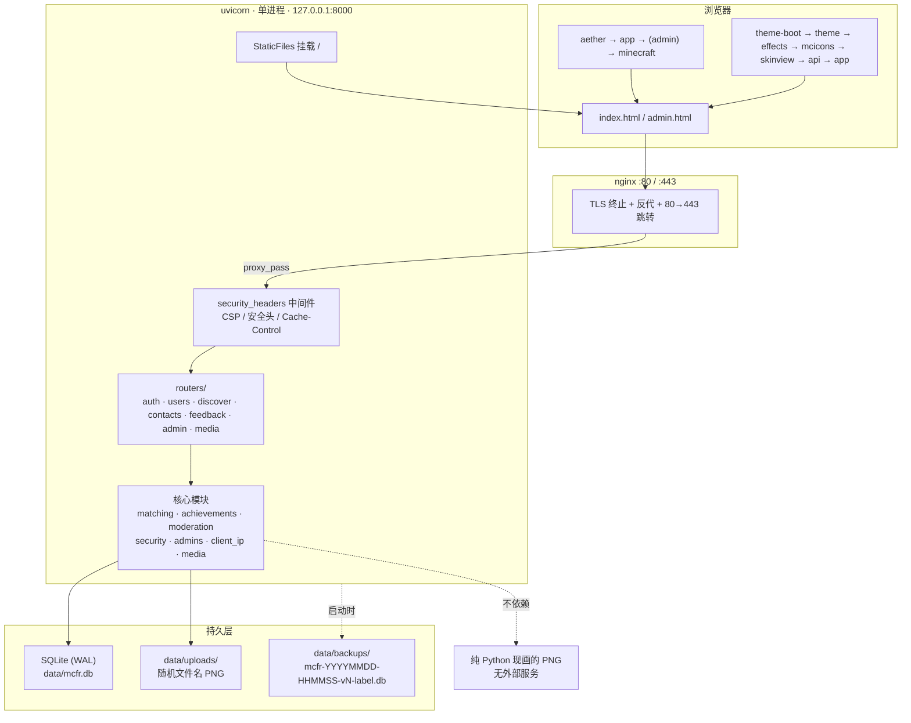

# mcfr 技术总结

> 面向中小学生《我的世界》玩家的安全交友平台
> 应用版本 `0.22.0` ｜ 数据库结构版本 `3`
> 线上地址 <https://pccode.cn>

本文是**技术向**的完整盘点：技术栈、架构、数据模型、算法、安全机制、部署方案与踩过的坑。
产品功能与使用说明见 `README.md`，本文不重复。

---

## 目录

1. [技术栈总览](#一技术栈总览)
2. [总体架构](#二总体架构)
3. [后端技术](#三后端技术)
4. [数据库技术](#四数据库技术)
5. [前端技术](#五前端技术)
6. [安全技术](#六安全技术)
7. [前后端通信约定](#七前后端通信约定)
8. [接口清单](#八接口清单)
9. [部署与运维](#九部署与运维)
10. [测试](#十测试)
11. [版本与里程碑](#十一版本与里程碑)
12. [关键设计决策与踩过的坑](#十二关键设计决策与踩过的坑)
13. [已知问题与待确认](#十三已知问题与待确认)

---

## 一、技术栈总览

| 层次 | 技术选型 | 版本 | 选型理由 |
| --- | --- | --- | --- |
| 后端语言 | Python | 3.11+（本地 3.13，服务器 Debian 12 自带 3.11） | 开题报告技术选型 |
| Web 框架 | FastAPI | `>=0.115` | 自带 Pydantic 校验与 OpenAPI，类型友好 |
| ASGI 服务器 | uvicorn | `>=0.30`（`[standard]`） | FastAPI 官方推荐；`[standard]` 顺带带来 `python-dotenv` |
| 数据校验 | Pydantic **v2** | 随 fastapi | `field_validator` 风格 |
| 数据库 | SQLite | 3.x（需 3.35+ 才用 `DROP COLUMN`） | 单文件、零配置、免装服务，适合校园电脑直接跑 |
| 前端 | 原生 HTML + CSS + JavaScript | — | **无框架、无构建、无 npm、无 CDN** |
| 字体 | Press Start 2P（latin 子集，自托管） | woff2 12.5 KB | 像素风标题数字；SIL OFL 1.1 |
| 人机验证 | 纯标准库现画 PNG（`zlib` + `struct`） | — | 不引 Pillow，也不接 reCAPTCHA 这类外部服务 |
| 图片处理 | **无图像库**（纯字节解析 PNG） | — | 不引 Pillow |
| 上传协议 | 原始请求体（`image/png`）+ `FileResponse` | — | 不用 multipart，省掉 `python-multipart` |
| 反向代理 | nginx | 系统包 | 终止 TLS、转发到 `127.0.0.1` |
| TLS 证书 | Let's Encrypt + certbot | 系统包 | 免费自动续期 |
| 进程管理 | systemd | 系统包 | 开机自启、崩溃自动重启 |
| 防火墙 | ufw（系统层）+ 阿里云安全组（云层） | — | 两层都要开 |
| 部署方式 | 自研 `deploy.sh`（14 步） | — | 一条命令完成全流程，带自检与回滚 |
| 回归测试 | 自研 `test_deploy.sh`（37 项断言） | — | 覆盖 deploy.sh 的函数级与流程级行为 |

### 依赖硬约束

`requirements.txt` **只有两行**：

```
fastapi>=0.115
uvicorn[standard]>=0.30
```

全项目扫描后确认：**没有引入任何其他第三方包**。以下都是为守住这条约束而做的选型：

| 通常会用 | 本项目改为 | 原因 |
| --- | --- | --- |
| Pillow 校验图片尺寸 | 纯字节解析 PNG（魔数 + `IHDR` + `struct.unpack(">II", …)`） | 免编译依赖 |
| `python-multipart` 收上传 | 原始请求体 + `Content-Type: image/png` | 免依赖，且前端用 Canvas 预缩放 |
| bcrypt / argon2 | 标准库 `hashlib.pbkdf2_hmac` | 校园电脑上装 bcrypt 常需要编译工具链 |
| `python-dotenv` 强制依赖 | 可选导入，失败时用内置 30 行解析器兜底 | `uvicorn[standard]` 已附带，没装也能跑 |
| 第三方验证码服务 | 自己用 `zlib` + `struct` 手写 PNG 编码 + 内置点阵字库 | 外链脚本会被 CSP 拦掉；而且**不能把学生的 IP 交给第三方** |
| three.js 做 3D 皮肤 | 自研 Canvas 2D 仿射贴图（见 [5.4](#54-自研-3d-皮肤渲染-skinviewjs)） | 校园网下外链经常加载不出来 |
| JWT 做会话 | 数据库不透明令牌 | **可即时吊销**，登出/封禁/改密立刻生效 |

---

## 二、总体架构



### 启动时序

```
python run.py --host 127.0.0.1 --port 8000
  └─ uvicorn.run("backend.main:app", proxy_headers=False)   ← 见 6.5，这行不能删
       └─ backend/__init__.py  先 load_env() 读 .env
            └─ main.py lifespan:
                 1. upgrade.run_upgrade()     备份 → 迁移 → 自检 → 失败自动整库回滚
                 2. admins.ensure_super_admin()  保证超管存在
                 3. admins.seed_from_env_password()
                 4. 打印一行「注册 / 登录用图片验证码（无外部依赖）」
```

**升级失败不阻断启动**：`lifespan` 刻意捕获 `Exception`（不只是业务异常），磁盘满、文件被占用等情况也不让整站打不开 —— 数据库已回滚成升级前的样子，用旧版本继续对外服务，同时把错误打清楚。

---

## 三、后端技术

### 3.1 模块结构

| 文件 | 行数（约） | 职责 |
| --- | --- | --- |
| `run.py` | 250 | 启动器：`argparse` 解析、CLI 工具子命令、调用 uvicorn |
| `backend/__init__.py` | 25 | 包入口，在一切之前 `load_env()`；声明 `__version__` |
| `backend/main.py` | 287 | FastAPI 装配：lifespan、安全头中间件、CORS、异常处理、路由挂载、SPA 路由、静态文件 |
| `backend/config.py` | — | `.env` 加载与回写（`load_env` / `update_env` / `env_file_hint`） |
| `backend/database.py` | 603 | 连接管理、`SCHEMA`、增量迁移、数据订正 |
| `backend/upgrade.py` | 745 | 升级编排、备份、回滚、导出/导入、状态查询 |
| `backend/security.py` | 136 | 口令哈希、令牌、服务端签名（验证码答案的 HMAC） |
| `backend/admins.py` | 305 | 两级管理员体系与逐模块权限 |
| `backend/deps.py` | 70 | 登录态依赖（`get_current_user` / `get_optional_user`） |
| `backend/client_ip.py` | 150 | 真实来源 IP 判定的**唯一实现** |
| `backend/matching.py` | 200 | 可解释匹配算法 + `to_public()` 数据边界 |
| `backend/achievements.py` | 584 | 成就定义与解锁判定（每条自带 target + progress）、等级换算 |
| `backend/moderation.py` | 130 | 未成年人社区内容防线 |
| `backend/media.py` | 165 | PNG 校验、落盘、取用 |
| `backend/captcha.py` | 416 | 图片验证码：点阵字库 + 干扰线 + 手写 PNG 编码 + 发凭据与校验 |
| `backend/schemas.py` | 395 | Pydantic v2 请求模型 + 全站选项字典 |
| `backend/modrinth.py` | 226 | Modrinth 官方 API 的**最小客户端**（纯标准库） |
| `backend/mirror.py` | 880 | 镜像业务：索引落库、版本筛选、后台任务、文件下载、图标缓存、每日自动同步调度 |
| `backend/routers/` | — | 8 个业务路由模块，见第八节 |

### 3.2 关键技术手段

**请求校验统一收口**
`schemas.py` 里所有自由文本（昵称、简介、地区、打招呼语）都过一遍 `moderation.scan_text()`；命中就抛 `ValueError`，由 `main.py` 的 `RequestValidationError` 处理器压成一句中文 422。前端不需要为每个字段写校验文案。

**动态 SQL 的三处白名单**
SQL 全部参数化，只有三处拼接，且都受控：

| 位置 | 场景 | 防护 |
| --- | --- | --- |
| `auth._COUNTABLE_COLUMNS` | 限流时按 `email` 或 `sent_ip` 计数 | 集合白名单 |
| `users.EDITABLE_FIELDS` | 更新资料时拼 `SET` 子句 | 集合白名单 |
| `admin` 列表筛选 | 动态 `WHERE` 片段 | 固定字符串片段 + 值参数化，`LIMIT` 用 `Query(ge, le)` 卡死上限 |

**异常处理**
- 全局：Pydantic 报错 → 中文一句话（剥掉 `Value error, ` 前缀）。
- 业务：`CaptchaError`/`MediaError` 等转 400 + 字符串 `detail`，前端只认字符串 `detail`。

**SPA 路由**
6 个前端视图（`/discover` `/mirror` `/partners` `/achievements` `/me` `/register`）装饰器叠加在同一个处理函数上，返回同一个 `index.html`；前端用 History API 接管。

### 3.3 模组镜像（Modrinth 集成）

**为什么做这件事**
目标用户是中小学生，而 Modrinth 在国内访问时常很慢甚至打不开。与其让学生自己想办法，不如让本站把常用的那一小部分模组先镜像一份 —— 这正是本站“让 Minecraft 更容易上手”这个定位的延伸。

**零依赖调用 HTTP API**
`modrinth.py` 完全用标准库：`urllib.request` + `urllib.parse` + `json`。没有用 `httpx` / `requests` —— 项目从 v0.1 起就守着“`requirements.txt` 只有两行”这条线。只用到两个端点：

| 端点 | 用途 |
| --- | --- |
| `GET /v2/search?facets=[["project_type:mod"]]&index=downloads&limit=N` | 榜单（按下载量降序），拿到前 N 名 |
| `GET /v2/project/{id}/version` | 单个模组的全部版本（含文件、sha1、loaders、game_versions） |

> Modrinth 要求带一个可识别的 `User-Agent`。默认值是 `mcfr-mod-mirror/1.0 (self-hosted Minecraft community site)`，可用 `MCFR_MODRINTH_UA` 覆盖成带联系方式的形式。

**为什么只需要两个端点**（没去拉 `/project/{id}`）：
搜索结果里已经有 `title` / `description` / `icon_url` / `downloads` / `categories` —— 够画卡片了。
为了这几个字段再多打一轮请求，对一个“前 20 名”的榜单来说不划算。

**加载器要靠白名单拆出来**
Modrinth 的 `categories` 字段把**加载器与分类混在一起**（`fabric` 和 `adventure` 同一个数组）。所以带一份 `LOADERS` 元组，把两边拆开分别存 —— 否则前端会把 `adventure` 当成一个加载器列进筛选条。

**“镜像哪些版本”的筛选规则（`pick_versions`）**

管理员按「游戏版本 + 加载器」勾选，规则只有两条：

| 情况 | 取什么 |
| --- | --- |
| 勾了具体游戏版本 | 每个加载器下，**能覆盖该版本的最新 release**（每加载器一个） |
| 没勾游戏版本 | 每个加载器的**最新那个 release 所覆盖的游戏版本** |

顺序很重要：先按加载器分组，再在组内按发布时间降序取**第一个命中**的 —— 而不是“先取最新再检查是否命中”。后者在“最新版恰好没支持目标游戏版本”时会直接抽出空集。

另外两道限制：

- `MAX_SELECTED_PER_MOD = 24`：一个模组最多选 24 个文件。榜单头部的模组动辄上千个版本（Fabric API 有 1204 个），不卡住上下限磁盘会被吃光。
- `version_type` 只认 `release`：`beta` / `alpha` 不进默认结果，但可以手动勾。

**同步不覆盖管理员的决定**
`_store_mod()` 的 UPSERT 里，`SET` 子句**故意不包含** `mirrored` / `mirror_loaders` / `mirror_versions` 三列，而 `mirror_files` 只删 `local_name = ''` 的行。
效果：重复同步只会更新“世界上发生了什么”（新版本、新下载量），不会把管理员已经做过的选择抹成默认值，也不会把已经下载到磁盘的文件记录删掉。

**两个权限，不是一个**
「拉一份清单」和「往服务器上传几百 MB」是风险量级完全不同的两件事：前者只是读外部数据，后者占磁盘、占带宽、有版权风险。所以拆成 `mirror_sync` 与 `mirror_download` 两个 area，默认都不给，由超管逐个授予。

**任务在后台线程，不在请求里**
用 `threading.Thread(daemon=True)`，任务状态写 `mirror_jobs` 表，前端每 2 秒轮询。
不能让同步庁住一个 HTTP 请求：拉 20 个模组的版本清单要几十秒，中间任何一次网络抖动都会把连接拖死。
而进程重启后残留的 `running` 任务，由 `_sweep_stale_jobs` 按 `STALE_JOB_SECONDS = 30 分钟` 判超时改 `failed` —— 否则界面上会永远卡着一个“进行中”。

**每日自动同步：一个会睡觉的线程**

设置存在 `settings` 表里（`mirror.auto_sync` / `mirror.auto_hour` / `mirror.sync_limit`），
由管理员在后台自己开、自己选钟点和「下载量前几名」。

| 选择 | 理由 |
| --- | --- |
| 后台线程，不是 crontab | 项目要的是「一条命令就能跑起来」。多一个 crontab 就多一处「换机器忘了配」，而且在 systemd 外面，日志分成两半 |
| 不用 APScheduler | 零第三方依赖是硬约束 |
| 只起任务、不管怎么跑 | 真正的同步还是走 `start_job`，所以进度条、任务历史、失败语义与手动同步完全一致 |
| 判据是「过了设定的钟点」而不是「正好等于」 | 服务器在时间点前后重启、或者夜里关机白天才开，只要当天还没跑过就会补上 |
| 撞车时不记 `last_day` | 有别的任务在跑就推迟到下一分钟再试 —— 否则一次撞车就能让当天的同步直接泡汤 |
| 任务表里标 `auto = 1` | 晚上机器自己跑几条之后，列表里凭空多出一堆记录看着像被人登了号 |
| 只同步索引，不自动下载 | 下载要占磁盘，那个必须由人决定 |

**本地图标缓存**
同步时顺手把图标抓一份到 `data/mirror/icons/`。两个理由：

1. CSP 是 `img-src 'self' data: blob:`，外链图会被浏览器**直接拦掉**，根本显示不出来；
2. 就算把 CSP 放开，也等于“每开一次页面就把用户 IP 交给对方 CDN”，而这恰好是本功能想避免的事。

- 文件名 = `{mod_id}-{sha1(url)[:8]}{后缀}`。用 url 哈希而不是 `hash()`：前者跨进程稳定，后者每次启动都不一样，会导致图标反复重抓；带上哈希也意味着图标换了之后文件名跟着变，浏览器不会拿到旧图。
- 下载先用 `.part` 临时名，校验 sha1 之后再 `replace()` —— 中断只会留下一个 `.part`，不会被当成完整的文件。
- 大小上限 64 MB / 文件（`MAX_ICON_BYTES = 1 MB`），超限直接拒绝，不把服务器当文件中转站。

**路径穿越防护**
所有路径都由 `safe_segment()`（把 `[^A-Za-z0-9._-]` 换成 `_`，去掉首尾 `.` / `_`，限 96 字符）+ `file_path()` / `icon_path()` 拼出来，拼完还要 `is_relative_to(MIRROR_DIR)` 再校验一次。两道，不是一道 —— 因为这里拼的是**文件名来自外部 API 的字符串**，而`..` 在 URL 里是合法字符。

---

## 四、数据库技术

### 4.1 连接与 PRAGMA

```python
sqlite3.connect(DB_PATH, timeout=15, check_same_thread=False)
row_factory = sqlite3.Row
PRAGMA foreign_keys = ON     # 保证 ON DELETE CASCADE 真的生效（删号要删干净）
PRAGMA busy_timeout = 8000   # 并发写时最多等 8 秒再报 database is locked
PRAGMA journal_mode = WAL    # 持久属性，只在建库/升级时设置
```

- `check_same_thread=False` 是**必须**的：FastAPI 的生成器依赖与同步路由可能跑在不同线程池线程上。
- `python run.py --host/--port` 默认监听 `127.0.0.1`，由 nginx 反代。

### 4.2 表结构（19 张）
| 表 | 用途 | 要点 |
| --- | --- | --- |
| `users` | 用户主表（34 列） | 账号、资料、三组 JSON 列表字段、联系方式、积分、隐私开关、`status` |
| `sessions` | 用户登录令牌 | `token` 主键，`ON DELETE CASCADE` |
| `admin_sessions` | **管理员独立会话** | 与用户会话物理隔离，普通令牌泄露也拿不到后台 |
| `admin_logins` | 管理员登录尝试 | 防爆破计数，按 IP + 时间索引 |
| `captchas` | 图片人机验证凭据 | 存 HMAC 哈希不存明文；`id` 是**随机串不是自增**（否则可枚举取图）；`attempts` / `created_ip` / `consumed_at` || `contact_requests` | 联系方式交换申请 | `pending` / `accepted` / `rejected` |
| `connections` | 已交换关系 | **无向**，用 `user_low < user_high` 存一份 |
| `blocks` | 屏蔽关系 | 有向 |
| `reports` | 用户举报 | 索引因建表顺序放在 `POST_MIGRATION_SQL` |
| `user_achievements` | 已解锁成就 | `(user_id, code)` 复合主键 |
| `interests` | 「跳过」记录 | `kind='skip'`，UPSERT 写入 |
| `upgrade_history` | 升级/安装历史 | 刻意存在库里，跟着备份一起走 |
| `feedback` | 意见反馈 | `user_id` 可空 = 匿名 |
| `admins` | 管理员账号 | `is_super` / `status` / `password_hash` |
| `admin_permissions` | 普通管理员逐模块权限 | `(area, level)`；**超管不走此表** |
| `mirror_mods` | 镜像模组（榜单条目） | Modrinth 项目 id 主键；`local_icon` 是本地图标文件名（不是外链）；`mirrored` / `mirror_loaders` / `mirror_versions` 是**管理员的决定** |
| `mirror_files` | 镜像模组的版本文件 | 外键 `ON DELETE CASCADE`；`selected` = 被版本/加载器筛中，`local_name` = 已落到磁盘 |
| `mirror_jobs` | 同步 / 下载任务 | 进度 `done/total/failed` 与最后一句 `detail`；进程重启后残留的 `running` 由 `_sweep_stale_jobs` 判超时；`auto=1` 表示这条是每日自动同步起的 |
| `settings` | 运行期设置（键值） | 由管理员在界面上改、需要跨重启保留、但不属于部署配置的东西。**只放了镜像自动同步那几项**，key 统一带 `mirror.` 前缀——这是各模块共用一张表时唯一的隔断方式 |

**索引**：SCHEMA 内 8 个 + `POST_MIGRATION_SQL` 补 2 个（含 `idx_users_email` —— `WHERE email != ''` 的**部分唯一索引**）。

> 索引不能写在建表语句之前：`reports` 的索引引用了一张更晚创建的表，全新数据库会直接报 `no such table: main.reports`。所有"索引指向的表在后面才建"的语句一律后置。

### 4.3 迁移机制

**两个版本号要分清**

| 名称 | 存储位置 | 当前值 | 含义 |
| --- | --- | --- | --- |
| 应用版本 | `backend/__init__.py` | `0.22.0` | 代码版本 |
| 结构版本 | `PRAGMA user_version` | `3` | 数据订正步骤的最大版本号 |

结构版本由 `DATA_MIGRATIONS` **自动推导**，避免"加了步骤忘了改版本号"。

**已执行的数据订正**

| 版本 | 内容 |
| --- | --- |
| v1 | 清除 12 个内置演示账号（用 `user_version` 标记一次性执行，而不是每次启动都删） |
| v2 | 删除微软登录遗留列 `ms_uuid / ms_name / skin_url / skin_variant / cape_url / ms_bound_at`（`DROP COLUMN` 需 SQLite 3.35+，失败静默） |

**结构迁移**（与数据订正分离，纯幂等）
`apply_schema()` = 执行 `SCHEMA`（全部 `IF NOT EXISTS`）→ `migrate()` 补列（users 15 个 + 其他表 4 个，先 `PRAGMA table_info` 再决定是否 `ALTER`）→ 建后置索引 → 接管旧的 `blocklink.db`。

> `LEGACY_TABLES` 里 5 张废弃表每次启动 `DROP TABLE IF EXISTS`；`LEGACY_USER_COLUMNS` 的 6 个旧列由 v2 订正移除。
> **新加的列一律用 `mc_` 前缀**：早期用过 `ms_*`，而 v2 订正会在**全新安装**时把它们删掉 —— 这个 bug 只在全新环境出现，极难排查。

### 4.4 升级、备份与回滚

**三条硬承诺**（写在 `upgrade.py` 文件头）

1. 动结构前**必先备份**；
2. 任何错误**自动整体回滚**；
3. **绝不删用户数据**（自检时做用户数对账）。

**备份用 SQLite 在线备份 API**（`Connection.backup`），不用 `shutil.copy`：

- WAL 模式下直接拷 `.db` 会缺最新写入的内容；
- Windows 上被打开的文件不能改名/删除。

**原子落盘**：先写 `.part`，完成后再改名 —— 防断电留下半截文件。
**命名**：`mcfr-YYYYMMDD-HHMMSS-vN-label.db`，正则校验（解析时**不能**用 `rsplit("-v", 1)`，标签本身可能含 `-v`）。
**保留**：最多 12 份，`protect` 保护的那份（升级前快照）永不删。

**升级流程**

```
run_upgrade()
  ├─ 全新库？ → 直接建库，记 install
  └─ 否则:
       1. pending_work() 检测（缺表 / 缺列 / 废表 / 待订正）
       2. 无待办 → 直接返回 up-to-date
       3. create_backup("pre-upgrade-vN")
       4. apply_pending()  建表 + 补列 + 订正
       5. health_check()   integrity_check + foreign_key_check + users 可读
       6. 用户数对账（预期减少量 = 库里现存演示账号数，而非简单"不能变少"）
       7. prune_backups()
       8. 写 upgrade_history
  异常 → copy_database(备份, DB_PATH) 整库盖回 → 记 failed
        → 回滚再失败则打印手工恢复指引
```

**导入 / 还原**

```
校验（≥512B、SQLite 魔数、integrity_check、必须有 users 表、≤64MB）
  → 先存 pre-restore / pre-import 快照
  → 覆盖 DB_PATH
  → 补回 PRAGMA journal_mode=WAL
  → 把当前管理员令牌写回 admin_sessions（8 小时）  ← 否则管理员做完还原当场被踢
  → 自动 run_upgrade() 追平旧库结构
```

**并发保护**：`threading.RLock` 串行化备份/还原/导入/升级。**必须 RLock** —— 接口之间会互相调用（导入 → 还原 → 升级），同一线程二次加同一把非可重入锁会自锁死。

---

## 五、前端技术

### 5.1 零构建零依赖

| 项 | 结论 |
| --- | --- |
| npm / `package.json` / 打包产物 | **没有** |
| CDN 外链 | **没有**（全仓库唯一的 http 链接是页面里用户主动点的 ICP 备案超链接） |
| 外部字体 | 没有，唯一字体自托管在 `frontend/fonts/` |
| 内联 `<script>` / `<style>` | 没有（受 CSP 约束，见 [6.6](#66-csp-与安全响应头)） |
| 脚本类型 | 全部是**经典脚本**（无 `type="module"`、无 `defer`/`async`），按文档顺序同步执行 |

规模：HTML 351 行 ｜ CSS 2,924 行 ｜ JS 5,089 行（合计约 8,364 行）。

### 5.2 CSS 架构与加载顺序

```
index.html ：aether.css → app.css → minecraft.css
admin.html ：aether.css → app.css → admin.css → minecraft.css
```

| 层 | 文件 | 定位 |
| --- | --- | --- |
| 1 | `aether.css`（1,055 行） | **设计系统 / 唯一真值来源**：`:root` 令牌、重置、原子组件、`html[data-theme="dark"]` 覆盖块 |
| 2 | `app.css`（1,083 行） | 应用层：按页面顺序搭建具体界面 |
| 2.5 | `admin.css`（276 行） | 后台专属 |
| 3 | `minecraft.css`（510 行） | MC 元素层，**必须最后加载**——它的定位就是"覆盖" |

> `minecraft.css` 里 `.mc-grass:hover` 与 `app.css` 的 `.btn-primary:hover` **特异性完全相同（0,3,0）**，能生效完全依赖源顺序。

**令牌体系要点**（`aether.css`）

- 分组命名：表面 / 中性叠加 / 描边 / 文本 / 品牌 / 语义色 / 模式相关 / 字体 / 圆角 / 阴影 / 缓动。
- **每个文本令牌都标注了对比度**（如 `--muted` ≈5.0:1、`--dim` ≈3.4:1 只给装饰）。
- 品牌绿是中亮度，**绿底一律配深墨绿字**（`--on-grass`，5.9:1）；白字在草绿上只有 2.8:1，不合格。
- 保留了一批早期"虹彩"主题的兼容别名（`--cyan / --magenta / --amber / --iris …`）：全站引用上百处，改名收益为零、漏一处就是静默失效。
- 字体栈：`--font-sans / --font-display / --font-mono / --font-pixel`。像素字体**只**用于等级数字、积分、计数、短拉丁标签 —— 中文字形不存在，正文用会掉阅读速度。
- `html { color-scheme }` 跟着主题切，管住原生滚动条、`<select>` 展开列表、默认焦点环、自动填充底色。

### 5.3 JS 模块与加载顺序

| 顺序 | 文件 | 行数 | 职责 | 导出 |
| --- | --- | --- | --- | --- |
| 0 | `theme-boot.js` | 34 | 首帧前写 `data-theme`，防闪烁 | — |
| 1 | `theme.js` | 141 | 三态主题控制、填按钮文案、同步 `theme-color` | `window.McfrTheme` |
| 2 | `effects.js` | 414 | 涟漪 / 方块碎屑 / 离子画布 / 标签指示器 / 草方块纹理 | `window.McfrEffects` |
| 3 | `mcicons.js` | 267 | 程序化生成 SVG 图标 | `window.McfrIcons` |
| 4 | `skinview.js` | 540 | Canvas 2D 皮肤渲染 | `window.McfrSkin` |
| 5 | `api.js` | 186 | `Store` + `api()` + `apiUpload()` + `Api.*` | 全局函数 |
| 6 | `app.js` | 2,483 | 主站全部逻辑（IIFE，不导出任何全局） | — |

`admin.html` 只引 `theme.js → effects.js → admin.js`（1,823 行）—— 后台自带精简版 `api()` / `openModal()`，不依赖 `api.js` / `mcicons.js` / `skinview.js`。

**`theme-boot.js` 为什么必须在 `<head>` 里同步加载**

1. 它是**唯一**能在首帧绘制前改 `data-theme` 的时机；放 body 末尾或 `defer` 里都已经晚一步，深色系统用户会看到"先白闪一下再整页变黑"。
2. **不能改成内联脚本**：CSP 是 `script-src 'self'`，内联会被直接拦掉；为它开 `'unsafe-inline'` 等于丢掉全站 XSS 防护。用一次几百字节的本地请求换策略完整性。
3. 它的解析逻辑必须与 `theme.js` 的 `resolve()` 一致，否则表现为"首屏 A 色、下一帧 B 色"。
4. 整个 try/catch：隐私模式下读 `localStorage` 会抛异常，绝不能让它打断 `<head>` 后续解析。

### 5.4 自研 3D 皮肤渲染（`skinview.js`）

**没有 three.js，没有 WebGL**，是纯 Canvas 2D 的仿射贴图。原理：

```
64×64 皮肤贴图
  → 按 MC 的 UV 展开图（net）切成矩形
  → 每个身体部位当作长方体，boxFaces(uv, size) 算出 6 个面在 3D 空间的 4 个角
  → 正交投影（先绕 Y 轴旋转，再绕 X 轴俯 TILT=0.20）
  → 每个面投影后仍是平行四边形
  → 平行四边形能由 ctx.setTransform(a,b,c,d,e,f) 精确表示
      ⇒ 用 TL/TR/BL 三点反解仿射矩阵 → clip 出四边形 → drawImage 贴图
  → facesCamera() 按旋转后的法线 z 分量做背面剔除
  → 可见面按平均深度排序（画家算法）从远到近画
```

细节处理：

| 项 | 做法 |
| --- | --- |
| 覆盖层（帽子/外套/袖子/裤腿） | 同一长方体各轴 `inflate(…, 0.5)` 外扩再画一遍，深度 `+0.001` 压在基础层上 |
| 老皮肤兼容 | `naturalHeight <= 32` 判定为 2014 年前的 64×32 皮肤，左臂/左腿用右侧贴图**镜像** |
| 披风 | 10×16 厚 1 的薄片，绕**顶端挂点**旋转（绕脚底转会把披风平移到身体外） |
| DPR | 整段渲染在设备像素坐标系做（`setTransform` 会覆盖缩放，不能 `ctx.scale(dpr,dpr)`），上限 2 |
| 平滑 | `imageSmoothingEnabled = false`，保持像素感 |
| 交互 | `pointerdown/move/up` + `setPointerCapture`；拖拽带惯性（`FRICTION=0.93`），双击回正，空闲时自转 |
| 平面头像 | `renderHead()` 直接 `drawImage` 正面 `(8,8,8,8)` + 帽子层 `(40,8,8,8)` |

**自动挂载约定**：扫描 `canvas[data-skin-model]`（3D）与 `canvas[data-skin-head]`（平面头像），可选 `data-cape / data-variant / data-angle / data-spin`；纹理缓存用 `Map`，注册表用 `Set`，循环自动清理已从 DOM 摘除或 `clientWidth === 0` 的项。

### 5.5 图标系统（`mcicons.js`）

三条自律（写在文件头）：

1. **只借形不借色** —— 全部用 `currentColor` + 不同 `opacity` 表达明暗面，所以同一图标能复用在"未解锁（灰）/ 解锁（绿金钻青）/ 卡片 / 弹窗 / 个人页"五种场合。
2. **两套造型语言** —— 方块类走**等距投影**（顶面 1.0 / 右面 0.70 / 左面 0.48 明度分层）；符号类走平面形 + 1.5px 偏移的低透明度侧影。
3. **几何全部算出来** —— `rhombus()` 出菱形、`iso()` 出等距立方体三面、`solid()` 铺面、`bevel()` 画倒角。

颜色语义通过**行内 CSS 变量** `--tone` 注入（`toneStyle()` 生成），而不是四个状态类 —— 因为同一图标还会出现在没有 `.badge` 祖先的地方。

覆盖 28 个成就 code + 5 个侧栏线条图标；所有 SVG 都 `aria-hidden="true" focusable="false"`。

> ！加新成就时必须同步在 `mcicons.js` 的 `BADGES` 里登记，否则它会退回成
> 后端给的 `glyph` 字符 —— 一个网格里既有体素图标又有纯文字符号，很显眼。
> 两道保险都留着：`badge()` 有 fallback，不会空一块；但别依赖它。

### 5.6 特效系统（`effects.js`）

| 特效 | 实现要点 |
| --- | --- |
| 草方块程序纹理 | 16×16 `<canvas>` + **固定种子的线性同余伪随机**逐像素绘制，输出 `data:image/png`；只复刻"上缘参差草绿 + 下面泥土棕 + 偶发石子"两个辨识特征，**不去取游戏贴图**（那是 Mojang 美术资源） |
| 点击涟漪 | `pointerdown`（忽略非左键）+ `{ passive: true }`，620ms 后移除 |
| 方块碎屑 | 每次 6 粒，方向写进 CSS 变量 `--dx/--dy`，末段由关键帧模拟重力 |
| 离子流动 | 粒子数按面积自适应 `clamp(area/26000, 26, 76)`；DPR 上限 2；**用平方距离省开方**；**限帧 30fps**；`visibilitychange` 隐藏时暂停；`resize` 200ms 防抖 |
| 标签指示器 | `WeakMap` 记住上次选中项 → 算出方向 ±1；把当前项 `getBoundingClientRect()` 写成 `--tab-x/y/w/h` 给容器 `::before` 用 |

> 指示器**必须是容器的伪元素**：侧栏每次切页都 `innerHTML` 重建子节点，插进去的元素会被一并抹掉。
> 首次挂载要**双 `requestAnimationFrame`** 后才加 `.is-ready` 开过渡，否则指示器会从 `(0,0)` 一路滑过来。

### 5.7 主题系统

| 项 | 结论 |
| --- | --- |
| 套数 | 2 套实际主题（light / dark）+ 1 个偏好档（跟随系统）= **三态循环** |
| 机制 | `<html data-theme="light|dark">` + `aether.css` 里唯一一个 `html[data-theme="dark"]` 覆盖块 |
| 刻意不做 | 不写 `@media (prefers-color-scheme: dark)` 副本 —— 两份真值迟早静默不同步；"跟随系统"在 JS 里就解析掉了 |
| 切换 | 任意位置放 `<button data-theme-toggle>`，用**事件委托**在 `document` 上监听（后台顶栏的按钮是登录后才出现的） |
| 持久化 | `localStorage["mcfr.theme"]`，只存偏好不存解析结果 |
| 图标 | `◐` / `☀` / `☾` —— 刻意不用 emoji，三平台画风不一且自带颜色 |
| 深色令牌三原则 | ① 色相不变、明度按深底重算；② 透明叠加要加不透明度；③ 阴影更黑更重 |
| 附带同步 | `meta[name=theme-color]` 与 CSS 的 `color-scheme` 一起切 |

### 5.8 无障碍与响应式

**无障碍**
- 全部交互控件是真 `<button>` / `<label>` / `<form>`，没有 `<div onclick>`。
- ARIA：`role="tablist"/"tab"` + `aria-selected`；侧栏 `aria-current`；chip/开关/权限档位用 `aria-pressed` / `aria-checked`；模态 `role="dialog" aria-modal="true"`；装饰性 canvas/SVG 一律 `aria-hidden`。
- 焦点可见：`outline: 2px solid var(--diamond); outline-offset: 2px` —— 用钻石青而非品牌绿，避免和主按钮混淆。
- 键盘：Escape 关闭任意模态；后台搜索框支持回车。
- `prefers-reduced-motion`：全局把动画压到 `.001ms`；额外关掉碎屑、经验球光晕、草方块过渡、离子画布，皮肤停止自转。
- 对比度逐项算过并写进注释（详见 `aether.css`）。

**响应式**
- 主力是 Grid + `auto-fill/minmax()`（`.peer-grid` 292px、`.badge-grid` 196px、`.stat-grid` 168px）与 `clamp()` 流体尺寸。
- 断点：`1080px` / `900px` / `760px` / `720px` / `640px`。
- 跨过 `900px` 时侧栏从 sticky 竖列变成**横向滚动条**；跨过 `760px` 顶栏精简。
- 触控：`.skin-canvas { touch-action: none }`，手机上左右拖不会变成翻页。

---

## 六、安全技术

### 6.1 口令与会话

| 项 | 实现 |
| --- | --- |
| 哈希算法 | **PBKDF2-HMAC-SHA256**，200,000 次迭代，16 字节随机盐 |
| 存储格式 | `pbkdf2_sha256$200000$salt_hex$digest_hex` |
| 比对 | `hmac.compare_digest`（恒定时间），任何异常一律视为失败 |
| 用户会话 | `secrets.token_urlsafe(32)`，14 天，存 `sessions` 表 |
| 管理员会话 | 独立 `admin_sessions` 表，8 小时 |
| 吊销 | 登出 / 改密 / 封禁 / 注销 全部即时失效（所以不用 JWT） |
| 令牌表清理 | 发新令牌时顺手 `DELETE WHERE expires_at <= now` |

**防账号枚举**：`DUMMY_HASH`（格式与真哈希一致但永不匹配）用于对不存在的账号跑同样开销的校验，拉平响应耗时。用户登录与管理员登录都用了这招。

### 6.2 人机验证（图片验证码）

图是 `backend/captcha.py` 用纯标准库现画的 —— 没有 Pillow，也没有外链任何验证码服务。

| 环节 | 做法 |
| --- | --- |
| 字符表 | 31 个字符，**去掉了 `0 O 1 I L`** —— 小字号点阵下这几个分不清，难住的只有真人 |
| 位数 | 4 位 = 92 万种组合 |
| 生成 | `secrets.choice`（CSPRNG） |
| 存储 | **不存明文**：`HMAC-SHA256(服务端持久密钥, "captcha:{id}:{答案}")`，`compare_digest` 比对 |
| 凭据 id | `secrets.token_urlsafe(18)` —— **随机串而不是自增整数** |
| 有效期 | 5 分钟 |
| 试错上限 | 5 次作废，必须换新的 |
| 一次性 | 成功后立刻写 `consumed_at`，防重放（已实测） |
| 用途隔离 | `login` / `register` / `admin` 三条路不能串用 |
| 大小写 | 不区分（`l` 认成 `I` 是笔误，不是攻击） |

> **答案为什么要跟 id 绑在一起做 HMAC**：答案只有 4 位、才 92 万种组合。
> 如果哈希只算答案本身，拿到一条哈希就能离线建表；带上 id 之后，
> 每个 id 的哈希表都得重算一遍，离线撞的成本直接乘上 id 的数量。
>
> **为什么要用随机 id 而不是自增**：自增就能被枚举，而枚举意味着可以
> 批量取图去做离线破解 —— 一张一张撞很慢，一万张一起撞就不一样了。

> **明文答案只存在于 `captcha.issue()` 的局部变量里**：落库的是哈希，出去的是图片，
> 调用方拿不到答案，也就没时机把它写进日志或响应体。
> 本项目的端到端测试想走通正常流程，也只能拿着库里的哈希把 92 万种组合撞一遍
> （`_e2e_auth.py` 的 `solve()`）—— 这反过来证明了库里存的确实是哈希。

**PNG 是怎么画出来的**（没有图像库，PNG 也得自己编码）：

```
4 位字符
  → 内置 5×7 点阵字库（`_FONT`，31 个字形，用 '#' 写成一行、'/' 分行，能直接肉眼校对）
  → 每像素放大成 3×3，逐字上下抖动 ±3px
  → 先撒浅噪点 → 叠 3 条正弦干扰线（压在字上面）→ 再撒深噪点
  → 真彩 8 位深、逐行过滤器固定 0，用 zlib.compress + zlib.crc32 拼成 PNG
```

与站内其他图形约定一致：不取任何外部素材，干扰线是算出来的（参见 5.6 的草方块纹理）。

> **为什么不用 reCAPTCHA / hCaptcha**：除了「零依赖 + 不用外部 CDN」这两条硬约束
> （外链脚本会被 CSP 的 `script-src 'self'` 直接拦掉），更要紧的是**隐私** ——
> 挂一个第三方验证码，等于用户每登录一次就把 IP 交给那家公司。
> 本站用户以未成年人为主，这一点不能妥协。
> 自己画则完全闭环：图片在服务器本地算出来，一个字节都不出去。

### 6.3 限流

全部是**窗口内 `COUNT(*)` 计数**式（不用滑动窗口，逻辑简单可审计）：

| 场景 | 限制 |
| --- | --- |
| 管理员登录 | 每 IP 15 分钟内 **5 次失败**（成功即清零该 IP 记录） |
| 人机验证 - 领取 | 每 IP 每小时 **120 张** |
| 意见反馈 - IP | 每小时 5 条 / 每天 20 条 |
| 意见反馈 - 账号 | 登录用户额外按账号 **每小时 5 条** |

> **一条限流顶两条用**：因为每次注册 / 登录都必须先领一张验证码图，
> 所以「领图限流」直接就是**登录尝试速率的上限** —— 120 张/小时即 120 次密码尝试/小时。
> 这个数字是按「学校机房 / 宿舍共用一个出口 IP，一节课 30 人同时登录」估的：
> 既不会误伤，又让脚本慢到没有意义。
>
> 早期版本这里是「同邮箱 60 秒冷却 / 每小时 6 条 / 每天 10 条 / 每 IP 每天 40 条」——
> 那是按「别把站点做成邮件轰炸机」设计的，邮件一取消，这套规则也就失去了对象。

### 6.4 防账号枚举

两条独立的路子，都要堵：

**① 响应耗时**。`DUMMY_HASH`（格式与真哈希一致但永不匹配）用于对不存在的账号
跑同样开销的校验，拉平响应时间。用户登录与管理员登录都用了这招。

**② 校验顺序**。人机验证**必须排在查数据库之前**：如果先查账号再验验证码，
「账号存不存在」会从耗时上泄出来（存在时要多跑一次 PBKDF2，几十毫秒；
不存在时几乎立刻返回）。先卡验证码，两种情况就在同一步被挡下，时间差就没了。

> 早期版本还有第三层：`login` / `reset` 用途的邮箱即使不存在也不提前返回，
> 继续走完限流与落库，只在最后一步决定要不要真发信 —— 那是为了让
> 「这个邮箱注册过没有」不可观测。邮件取消后这一层随之删除。
> 那套逻辑的代价是表里会积一批永远用不上的记录，也是取消邮件时顺手清掉的东西之一。

### 6.5 来源 IP 判定

这是全站按 IP 限流的**唯一依赖**，也是踩过坑的地方。

```python
# run.py —— 这一行必须留着，别删
uvicorn.run("backend.main:app", ..., proxy_headers=False)
```

**双层保险**：

1. **uvicorn 层**：`proxy_headers=False`。uvicorn 默认只要来源在 `--forwarded-allow-ips` 里（默认 `127.0.0.1`）就会拿 `X-Forwarded-For` 的值**替换** `request.client.host`。而那个头客户端可以随便伪造 —— 被它改写之后，应用层再怎么写校验都没用。
2. **应用层**：`client_ip.py` 是 IP 判定的**唯一实现**。默认**完全不看** XFF；只有 `MCFR_TRUSTED_PROXIES` 显式配置了代理网段才解析，且**从右往左**找第一个不可信地址（右侧由自己人逐跳追加，最可信）。无法确定时返回空串，让调用方退化成"不按 IP 限流"。

> 曾因这个头导致三处限流同时失效：管理员登录失败限制（可无限暴破后台口令）、人机验证领取限制（可无限取图去离线破解）、反馈频率限制；而且失败记录里存的 IP 全是假的，出事后查不到人。

部署时由 `deploy.sh` 在启用 nginx 时自动写入 `MCFR_TRUSTED_PROXIES=127.0.0.1`。

### 6.6 CSP 与安全响应头

```
default-src 'self'; script-src 'self'; style-src 'self' 'unsafe-inline';
img-src 'self' data: blob:; font-src 'self'; connect-src 'self';
object-src 'none'; base-uri 'self'; form-action 'self'; frame-ancestors 'none'
```

| 头 | 值 |
| --- | --- |
| `X-Content-Type-Options` | `nosniff` |
| `X-Frame-Options` | `DENY` |
| `Referrer-Policy` | `same-origin` |
| `Permissions-Policy` | `geolocation=(), camera=(), microphone=()` |

- `script-src 'self'` 意味着**禁止任何内联脚本** —— 这就是主题防闪烁代码被抽成外部文件的原因。
- `style-src` 放开了 `'unsafe-inline'`：样式属性（`style="..."`）用得很多，而 CSS 注入的危害远小于脚本注入。
- **CORS 默认关闭**：只有 `MCFR_ALLOWED_ORIGINS` 显式列出才装中间件，且 `allow_credentials=False`。

### 6.7 缓存策略

| 路径 | 响应头 | 原因 |
| --- | --- | --- |
| 除 `/api/media/` 外的一切 | `Cache-Control: no-cache` | Starlette `StaticFiles` 只发 ETag/Last-Modified 不发 Cache-Control，浏览器会"启发式缓存"（新鲜期≈距修改时长的 10%，越老缓存越久），改完的 js/css 会继续被用旧的 |
| `/api/media/{filename}` | `public, max-age=2592000, immutable` | 文件名是 `secrets.token_hex(16)` 随机生成、内容不可变 |

前端所有 CSS/JS 另外都带 `?v=0.22.0` 版本戳。

### 6.8 上传安全

| 项 | 做法 |
| --- | --- |
| 协议 | 原始请求体，`Content-Type: image/png`；**不用 multipart** |
| 校验 | PNG 魔数（8 字节）+ `IHDR` 块 + `struct.unpack(">II", data[16:24])` 读宽高 |
| 尺寸白名单 | 头像 ≤1MB/最长边 512；皮肤 ≤512KB 且必须 64×64 或 64×32；披风 ≤256KB/64×32 |
| 落盘名 | `secrets.token_hex(16).png`，取用时再用 `^[0-9a-f]{32}\.png$` 正则兜底（防路径穿越） |
| 前端预处理 | Canvas 居中裁切并缩放到 256×256 PNG 再上传 —— 所以服务端不需要任何图像库 |
| 优势 | 服务端**没有图像解码器**，也就没有解码器漏洞面 |

### 6.9 内容审核

面向未成年人社区的第一道防线：

| 手段 | 说明 |
| --- | --- |
| 关键词 | 16 个默认词（导流/诈骗 13 + 外挂 3），可外置到 `data/blocked_keywords.txt`（`#` 注释、每行一条），文件不存在则回退内置表 |
| 手机号 | 正则 `(?<!\d)1[3-9]\d{9}(?!\d)`，命中拦截 |
| QQ / 微信 | 正则识别但**不拦截**（v0.2 起改为受控交换，仅界面引导） |
| 反绕过 | `normalize()` 先 `re.sub(r"[\s\u3000]+", "", text)` 去掉**所有空白与全角空格**，防"加 我 微 信" |
| 后台展示 | 举报内容用 `mask_contacts()` 打码 |
| 刻意不做 | 反馈内容不过滤 —— 反馈常含报错信息和联系方式，过滤会误伤；靠管理员人工处理 |

### 6.10 隐私边界

- `matching.to_public()` **从不输出** `password_hash` / `email`。
- 联系方式只在 `include_contact=True` 时附加，即**本人**或**已建立连接**。
- 后台用户列表**不返回联系方式内容**，只返回 `contact_prepared` 布尔值。
- 图片验证码在服务器本地生成，**不把用户 IP 交给任何第三方**。
- `show_online` 开关 + 5 分钟活跃窗口共同决定在线状态。

---

## 七、前后端通信约定

| 项 | 约定 |
| --- | --- |
| 认证 | `Authorization: Bearer <token>` |
| 主站令牌存储 | `localStorage["mcfr.token"]`（长期） |
| 后台令牌存储 | `sessionStorage["mcfr.admin.token"]`（**关标签页即失效**） |
| 错误约定 | 后端错误一律读 `detail` 字段，且**只认字符串**；否则显示兜底文案 —— 因为 500 的响应体不是 JSON，拿不到 `detail` |
| 401 处理 | 清 token + 清 user + 回调 `onUnauthorized()`（`app.js` 在 `boot()` 里挂上 `showAuth`，避免 `api.js` 直接依赖界面） |
| 上传 | 原始 PNG 二进制 + `Content-Type: image/png`，不用 `FormData` |
| 后台导入 DB | `Content-Type: application/octet-stream` + 自定义头 `X-Filename`（文件名需 `encodeURIComponent`，因为 HTTP 头只能放 ASCII） |
| 下载 | 必须用带 `Authorization` 头的 `fetch` + `Blob` + 临时 `<a download>`；不能直接 `<a href>`，那样不带令牌会 401。`URL.revokeObjectURL` 要**延迟 8 秒**（立刻 revoke 会让部分浏览器来不及取数据） |
| XSS 防护 | 所有插值走 `esc()` |

---

## 八、接口清单

**共 83 个路由装饰器。**

图例：🔓 公开 ｜ 👤 需登录 ｜ 🛡️ 任一管理员 ｜ 🔐 超管 ｜ 📦 `system` 模块权限 ｜ 💬 `feedback` 模块权限 ｜ 🧩 `mirror_sync` / `mirror_download` 权限

### 系统与页面（`main.py`）

| 方法 | 路径 | 作用 | 权限 |
| --- | --- | --- | --- |
| GET | `/api/health` | 健康检查 | 🔓 |
| GET | `/api/version` | 前后端/数据库版本（用于识破缓存旧版） | 🔓 |
| GET | `/api/meta` | 选项字典 + 公开统计 + 成就目录 + `mail_dev_mode` | 🔓 |
| GET | `/admin` | 后台页面 | 🔓（页面本身；数据接口要令牌） |
| GET | `/discover` `/partners` `/achievements` `/me` `/register` `/mirror` | 6 个 SPA 入口 | 🔓 |
| （mount） | `/` | 静态前端（`html=True`） | 🔓 |

### 认证 `/api/auth`（7）

| 方法 | 路径 | 作用 | 权限 |
| --- | --- | --- | --- |
| GET | `/api/captcha` | 领一张图片验证码（返回 base64 图 + 凭据 id） | 🔓 按 IP 限流 |
| POST | `/api/auth/register` | 注册（需人机验证） | 🔓 |
| POST | `/api/auth/login` | 密码登录（用户名或邮箱，需人机验证） | 🔓 |
| POST | `/api/auth/password` | 修改自己的密码（**含当前会话一并踢下**） | 👤 |
| POST | `/api/auth/logout` | 退出（清**全部**会话） | 👤 |
| DELETE | `/api/auth/account` | 注销删号（靠外键 CASCADE） | 👤 |

### 用户 `/api/users`（10）

| 方法 | 路径 | 作用 | 权限 |
| --- | --- | --- | --- |
| GET | `/api/users/me/overview` | 个人中心汇总 | 👤 |
| PUT | `/api/users/me` | 更新资料（白名单 12 字段） | 👤 |
| PATCH | `/api/users/me/privacy` | 隐私开关 | 👤 |
| GET | `/api/users/me/achievements` | 成就墙 | 👤 |
| GET | `/api/users/me/contacts` | 已交换联系人 | 👤 |
| GET | `/api/users/{user_id}` | 他人公开资料（+ 浏览量 + 徽章 + 匹配分） | 👤 |
| POST / DELETE | `/api/users/me/avatar` | 上传 / 移除头像 | 👤 |
| POST / DELETE | `/api/users/me/skin` | 上传 / 移除皮肤 | 👤 |
| GET | `/api/media/{filename}` | 读取图片 | 🔓 |

### 发现 `/api/discover`（3）

| 方法 | 路径 | 作用 | 权限 |
| --- | --- | --- | --- |
| GET | `/api/discover` | 推荐同好（按匹配分排序） | 👤 |
| GET | `/api/discover/search?q=` | **按昵称或用户名搜索同好** | 👤 |
| POST | `/api/discover/{target_id}/skip` | 跳过，不再推荐 | 👤 |

> 搜索与推荐是**两条相反的路径**：推荐排除已连接 / 已有待处理申请的人，
> 搜索不排除（已经交换过的人也应该搜得到），只双向排除屏蔽关系 ——
> 那是安全边界，不是偏好。
>
> `LIKE` 里的 `%` / `_` / `\` 必须转义（`ESCAPE '\'`），否则输一个 `%`
> 就等于「匹配所有人」，搜索框会变成一个全站用户列表入口。
> 关键词为空时直接返回空列表，不做退化查询。

### 模组镜像 `/api/mirror`（5）

| 方法 | 路径 | 作用 | 权限 |
| --- | --- | --- | --- |
| GET | `/api/mirror/overview` | 统计：模组数 / 已镜像 / 待下载 / 占用空间 | 👤 |
| GET | `/api/mirror/mods` | 模组列表（只给本地图标地址，不给外链） | 👤 |
| GET | `/api/mirror/mods/{mod_id}` | 模组详情 + 全部版本（标注哪些可下载） | 👤 |
| GET | `/api/mirror/icons/{mod_id}` | 本地缓存的模组图标 | 🔓 **无需令牌** |
| GET | `/api/mirror/files/{file_id}/download` | 下载已镜像的文件 | 👤 |

### 模组镜像后台 `/api/admin/mirror`（6）

| 方法 | 路径 | 作用 | 权限 |
| --- | --- | --- | --- |
| GET | `/api/admin/mirror/state` | 当前两个能力位 + 模组与任务列表 | 🧩 任一 |
| POST | `/api/admin/mirror/sync` | 开始同步模组索引 | 🧩 `sync` |
| PATCH | `/api/admin/mirror/mods/{mod_id}` | 改镜像开关 / 加载器 / 游戏版本 | 🧩 `download` |
| POST | `/api/admin/mirror/download` | 开始下载选中的文件 | 🧩 `download` |
| GET | `/api/admin/mirror/jobs/{job_id}` | 单个任务进度（前端 2 秒轮询） | 🧩 任一 |
| GET | `/api/admin/mirror/jobs` | 任务列表 | 🧩 任一 |
| PATCH | `/api/admin/mirror/settings` | 每日自动同步：开关 / 钟点 / 前几名 | 🧩 `sync` |

> 两个能力位是**独立**的，可以只给「同步索引」不给「镜像文件」。
> 只要有一个就能打开后台的「模组镜像」页签（`AREA_TABS` 把两个 area 映射到同一个 tab，`visible_tabs()` 去重）。
>
> 图标接口故意不鉴权：`` 发不出 `Authorization` 头。模组图标本来就是公开信息，
> 而它服务的是「所有登录用户」（页面本身需要令牌），所以这不构成泄露。
> `_brief()` 也不把 `download_url` / `icon_url` 交给前端 —— 直链一旦给出去，
> 本站的下载按钮就成了一句装饰。

### 社交 `/api`（12）

| 方法 | 路径 | 作用 | 权限 |
| --- | --- | --- | --- |
| GET | `/api/connections` | 已交换联系人（含联系方式） | 👤 |
| DELETE | `/api/connections/{peer_id}` | 解除交换 | 👤 |
| GET | `/api/contact-requests?box=` | 收/发件箱 | 👤 |
| GET | `/api/contact-requests/pending` | 待我处理（登录弹窗，≤20 条） | 👤 |
| POST | `/api/contact-requests/{target_id}` | 申请交换 | 👤 |
| POST | `/api/contact-requests/{request_id}/accept` | 同意交换 | 👤 |
| POST | `/api/contact-requests/{request_id}/reject` | 婉拒 | 👤 |
| GET / POST | `/api/blocks` | 屏蔽名单 / 添加屏蔽 | 👤 |
| DELETE | `/api/blocks/{target_id}` | 解除屏蔽 | 👤 |
| GET | `/api/reports/reasons` | 举报原因字典 | 👤 |
| POST | `/api/reports` | 提交举报 | 👤 |

### 反馈 `/api/feedback`（2）

| 方法 | 路径 | 作用 | 权限 |
| --- | --- | --- | --- |
| POST | `/api/feedback` | 提交反馈 | 🔓 匿名可用 |
| GET | `/api/feedback/mine` | 我的反馈（未登录返回空） | 🔓 可选 |

### 后台 `/api/admin`（26）

| 分组 | 接口 |
| --- | --- |
| 会话 | `POST /login` 🔓 · `GET /me` 🛡️ · `POST /logout` 🛡️ · `POST /password` 🛡️ |
| 概览 | `GET /overview` 🛡️ |
| 举报 | `GET /reports` · `POST /reports/{id}/resolve` · `POST /reports/{id}/reopen` 🛡️ |
| 安全记录 | `GET /security` 🛡️ |
| 用户 | `GET /users` · `POST /users/{id}/status` · `POST /users/{id}/reset-password` 🛡️ |
| 系统 | `GET /system` 📦view · `POST /system/backup` · `POST /system/upgrade` · `GET /system/export` · `GET /system/backup/{name}` · `POST /system/backup/{name}/restore` · `DELETE /system/backup/{name}` · `POST /system/import` 📦manage |
| 管理员 | `GET /admins` · `POST /admins` · `PATCH /admins/{id}` · `DELETE /admins/{id}` 🔐 |
| 反馈 | `GET /feedback` 💬view · `PATCH /feedback/{id}` · `DELETE /feedback/{id}` 💬manage |

> 超管对所有模块恒 True；普通管理员默认拥有 `overview / reports / users / mail` 四个基础页签。

### 核心算法：可解释匹配（`matching.match_score`）

不用协同过滤，而是**用户能直接看懂理由**的加权评分：

| 维度 | 分值 |
| --- | --- |
| 共同玩法 | 12 / 项，≤36 |
| 都想找的类型 | 8 / 项，≤16 |
| 共同在线时段 | 8 / 项，≤16 |
| 同游戏版本 | 14（有一方是"双版本通吃"则 12） |
| 同年龄段 | 8（相邻年龄段 4） |
| 同地区 | 10 |
| 填了简介 | 4 |
| 24 小时内活跃 | 6 |

总分封顶 100，最多输出 3 条**理由**给用户看。推荐候选由一条 SQL 排除（自己 / 非 active / 已跳过 / 双向屏蔽 / 已连接 / 已发或已收的申请），`LIMIT 120` 后在内存排序取前 N。

### 等级与成就（`achievements.py`）

- **等级阈值**：`(0, 30, 80, 150, 240, 340, 440, 540, 630, 720)` —— 10 级。
- **10 个中文称号**：新来的方块 → … → 传奇同好。
- **28 个成就**，总分 760。阈值就是照着这个数调的：满级 720，留 40 分容错，
  不必把最后一条献牲旮旯的成就也啃下来。
  > ！改阈值时只能往**低**或持平调。调高了，已经攒了分的老用户会凭空掉级。
- `collect_stats()` 用**一条聚合 SELECT + 7 条 COUNT** 喂全部成就，避免逐成就查库。
- `sync_achievements(extra=…)` 的 `extra` 用来注入**不入库的瞬时条件**
  （深夜 / 早上 / 周末登录），`INSERT OR IGNORE` 保证幂等。

#### 每条成就是「自带满值 + 自带进度」的

```python
{
    "code": "squad_five",
    "name": "五人小队",
    "desc": "与 5 位同好交换了联系方式",
    "target": 5,
    "progress": lambda s: _capped(s["connection_count"], 5),
}
# 解锁条件就是 progress >= target
```

v0.22 之前，同一件事写在三个地方：`ACHIEVEMENTS` 给名字和分值、
`_conditions()` 判定达没达成、`full_catalog()` 里两个手写字典管进度条。

加一条成就得动三处，漏一处的后果分别是「成就页 KeyError 直接打不开」
和「进度条永远停在 0/5」。而判定与进度条本来就是同一个条件，
现在它们共享同一个数，**不可能对不上**。

> 本文件说的「12 个成就」在 v0.22 变成了 28 个，同时新增了
> 「连续登录 3/7 天」「累计 30 天」这三条 —— 它们靠 users 表的
> `last_login_day` / `login_streak` / `login_days` 判定，
> 而这三个字段刻意**不**从 `sessions` 推导：登出、过期清理、封禁都会删那张表，
> 它记的是「现在活着的令牌」，不是「这个人来过哪些天」。

---

## 九、部署与运维

### 9.1 目录结构（刻意的设计）

```
/root/mcfr/                    ← 或者 --base /srv/mcfr
├── deploy.sh                  脚本会把自己复制到这里（自保护）
├── mc.zip                     发布包
├── mc/                        程序目录，每次升级整个重建
│   ├── run.py  backend/  frontend/  requirements.txt
│   ├── .env   ──软链接──►  ../shared/.env
│   └── data   ──软链接──►  ../shared/data
├── shared/                    **状态**，升级时绝不动它
│   ├── .env
│   └── data/{mcfr.db, server_secret.key, uploads/, backups/, mirror/}
├── venv/                      虚拟环境
└── backups/<时间戳>/          每次升级前的快照
```

**核心不变式**：所有状态都在 `mc/` **外面**，所以"清空 `mc/` 再解压"永远安全 —— 不需要维护一份"哪些目录不能删"的名单（那种名单迟早会漏，而漏掉的代价是用户数据）。

**以后加新的持久化目录**：放进 `shared/`，再在 `deploy.sh` 第 6 步加一条软链接。

### 9.2 `deploy.sh`（14 步）

| 步骤 | 内容 |
| --- | --- |
| 1 | 安装系统依赖（`--no-install` 可跳过） |
| 2 | 准备发布包（见下方来源优先级） |
| 3 | 解压发布包并校验（**先校验，后动手删**） |
| 4 | 停止服务（含清理手工启动的残留 `run.py` 进程） |
| 5 | 备份配置与数据（**服务停了才备份** —— SQLite 开 WAL，热拷贝可能拿到撕裂状态） |
| 6 | 安装程序文件（清空 `mc/` → 复制 → 剔除发布包里不该带的 → 建软链接） |
| 7 | 准备配置（旧配置导入 / 模板生成 / `MCFR_TRUSTED_PROXIES`） |
| 8 | 安装 Python 依赖（venv + pip，默认用清华源） |
| 9 | 配置 systemd 服务 |
| 10 | 配置 nginx 反向代理 |
| 11 | 配置防火墙（ufw） |
| 12 | 启动并自检 |
| 13 | 申请 HTTPS 证书 |
| 14 | 端到端自检（nginx 层 + 443 监听） |

**发布包来源优先级**（按顺序判断）：
1. `--zip` 指定了 → 用它
2. 脚本所在目录（或自保复制前的原目录）是项目根 → **现打一个**
3. 都不满足 → 用 `$BASE_DIR/mc.zip`（手工上传的那个，会**打印它的更新时间并警告**）

**命令行开关**

```
--dry-run                      只打印要做什么，不改任何东西
--domain pccode.cn             指定域名（默认自动沿用已配置的）
--port 8010                    换端口
--email you@example.com        申请证书用的邮箱
--zip /tmp/new.zip             指定发布包
--from-dir /path/to/project    从指定目录打包
--import-from /srv/mcfr        从旧安装目录搬 data 和 .env（换目录结构时用一次）
--rollback 20260924-143000     回滚到某次升级之前
--base /srv/mcfr               换部署根目录
--no-https / --no-firewall / --no-nginx / --no-install
--skip-deps
```

### 9.3 systemd 服务

```ini
[Unit]
Description=mcfr · Minecraft 同好匹配
After=network-online.target
Wants=network-online.target

[Service]
Type=simple
User=mcfr
Group=mcfr
WorkingDirectory=/root/mcfr/mc
ExecStart=/root/mcfr/venv/bin/python run.py --host 127.0.0.1 --port 8000
Restart=always
RestartSec=3
SyslogIdentifier=mcfr

NoNewPrivileges=true
PrivateTmp=true
ProtectSystem=full
ProtectKernelTunables=true
ProtectControlGroups=true
RestrictSUIDSGID=true

[Install]
WantedBy=multi-user.target
```

> **刻意没开 `ProtectHome`**：项目默认装在 `/root/mcfr`，开了会把 `/root` 整个藏起来，服务直接起不来。
> **`ProtectSystem=full` 是安全的**：程序目录只读即可，所有写入都发生在 `shared/data/`。

### 9.4 nginx 与证书

脚本生成的站点配置只监听 80，由 `certbot --nginx` 追加 443 与 80→443 跳转。

```nginx
server {
    listen 80;
    server_name pccode.cn;
    client_max_body_size 2m;
    location / {
        proxy_pass http://127.0.0.1:8000;
        proxy_http_version 1.1;
        proxy_set_header Host              $host;
        proxy_set_header X-Real-IP         $remote_addr;
        proxy_set_header X-Forwarded-For   $proxy_add_x_forwarded_for;
        proxy_set_header X-Forwarded-Proto $scheme;
    }
}
```

### 9.5 运维要点

| 事项 | 做法 |
| --- | --- |
| **`/root` 权限** | `/root` 默认 `700`，服务用户 `mcfr` 穿不过去，systemd 在 `cd WorkingDirectory` 时就失败（`status=200/CHDIR`）。脚本会自动给到工作目录的**每一层祖先**补 `o+x`（只要"穿过"不要"列目录"） |
| **两层防火墙** | ufw 放行 22/80/443，**阿里云控制台的安全组也必须放行**；系统防火墙开了、安全组没开照样连不上 |
| 上线后必查 | 故意输错一次管理员密码，然后 `sqlite3 mcfr.db "SELECT ip FROM admin_logins ORDER BY id DESC LIMIT 1;"` 应该显示自己的公网 IP；显示 `127.0.0.1` 说明 `MCFR_TRUSTED_PROXIES` 没生效 |
| 日志 | `journalctl -u mcfr -f` |
| 回滚 | `sudo bash deploy.sh --rollback <时间戳>`（恢复 `.env` 和 `data/`；代码要重新上传那一版的 zip） |

### 9.6 编码环境注意

开发机是 Windows，**不要用 PowerShell 改本项目的文本文件**：PS 5.1 不带 `-Encoding` 读 UTF-8 会按 GBK 解码，再写回时中文全部变成乱码（实测同时毁掉 `index.html` / `admin.html` / `__init__.py`）。一律用编辑器工具改。

---

## 十、测试

`test_deploy.sh` — `deploy.sh` 的回归测试，**37 项断言，6 个小节**。

| 节 | 内容 |
| --- | --- |
| A | 把 `deploy.sh` 主流程之前的函数定义抽出来 `source` 进来**单测真代码**（不测副本） |
| B | 造替身命令（`unzip` / `python3` / `nginx` / `certbot` / `ufw`） |
| C | 完整 dry-run（含"自动剥掉外层目录"的包结构识别） |
| D | 发布包自打包（`--from-dir`），并校验包内**不该带** `data/` 和 `.env` |
| E | 错误输入应被拦住（损坏包 / 缺 `run.py` / 缺 `backend/` / 缺 `frontend/`） |
| F | **自保复制后发布包来源不能退化**（照一次真实故障写的） |

**运行**：`bash test_deploy.sh`。改了 `deploy.sh` 之后必须跑一遍 —— 尤其是改「步骤顺序」「发布包来源」「配置读取」这三块。

**两个测试自身的坑**（都已修）：

1. `source funcs.sh` 会带上 `deploy.sh` 的 `set -e`，必须紧跟 `set +e`，否则"期望失败"的用例会把测试本身掀翻。
2. `source` 还会用 `deploy.sh` 自己的 `ok()` 覆盖测试的 `ok()` → `PASS` 永不加、末尾永远显示"通过 0 项"。所以 `source` 之后必须重新声明测试的 `ok/bad/skip/check` 并清零计数。

---

## 十一、版本与里程碑

| 版本 | 内容 |
| --- | --- |
| v0.2 | 确立社交模型：联系方式受控交换，站内不做聊天 |
| v0.3 | 站点更名 `mcfr`，数据库文件名同步调整（自动接管旧的 `blocklink.db`） |
| v0.9 | 用户上传自定义形象（头像 / 皮肤） |
| v0.10 | **升级支持**：启动时先备份再迁移，出错自动回滚 |
| v0.11 | 按《网站界面重构设计.txt》改为"现代体素主义"：云白底 + 草方块绿 |
| v0.12 | 主题绿加深；登录按钮换成"草方块 + 绿色渐变"两层 |
| v0.13 | 意见反馈 + 超级管理员 / 普通管理员两级账号体系 |
| v0.14 | 跟随系统的深浅主题（三态：跟随系统 / 浅色 / 深色） |
| v0.15 | 一轮安全加固：来源 IP 不再信任 `X-Forwarded-For`、防账号枚举、CSP 与安全响应头、收紧跨域、统一转义与表清理 |
| v0.16 | MC 抽象层的视觉改造：等距体素图标、物品栏式成就卡、经验条分格、旋转方块加载器、本地像素字体（**只动视觉，没碰业务逻辑**） |
| v0.17 | 静态资源缓存修复（`Cache-Control: no-cache` + `?v=`） |
| v0.18 | 移除微软正版登录（Mojang 白名单申请被拒，无申诉渠道）；`ms_*` 列进入数据订正 v2 |
| v0.19 | 发现页加搜索：顶部搜索栏 + `Ctrl + /` 快捷键，按昵称或用户名找人；结果复用推荐卡片。另外：新增 `run.py --check-mail`（只验证邮件「连得上、登得进」，不发信）、启动日志打印完整邮件配置、SMTP 错误带上状态码与服务器原文、堵住「SMTP 故障时可用登录/找回接口枚举邮箱」的漏洞 |
| v0.20 | **模组镜像**：左侧菜单新增「模组镜像」页。从 Modrinth 官方 API 同步下载量前 N 的常用模组及其全部版本清单，管理员按「游戏版本 + 加载器」勾选要镜像的版本并下载到本站。新增两张独立权限 `mirror_sync` / `mirror_download`，由超管逐个授予；同步与下载都是后台线程任务，前端轮询进度 |
| v0.20 | **模组镜像**：左侧菜单新增「模组镜像」页。从 Modrinth 官方 API 同步下载量前 N 的常用模组及其全部版本清单，管理员按「游戏版本 + 加载器」勾选要镜像的版本并下载到本站。新增两张独立权限 `mirror_sync` / `mirror_download`，由超管逐个授予；同步与下载都是后台线程任务，前端轮询进度 |
| v0.21 | **取消邮件功能**。注册、登录、找回密码都不再发信，邮箱降级成选填的普通资料字段；换成自研的图片验证码（`backend/captcha.py`，纯标准库画 PNG，不接任何外部服务）——**一张限流表同时就是登录尝试速率的上限**。同时补上了「修改自己的密码」（以前只能靠邮箱验证码重置，邮件一取消就彻底没路了）和「管理员重置用户密码」。后台「邮件记录」页签改成「安全记录」 |
| v0.22 | ① **成就从 12 条扩到 28 条**，总分 760，等级阈值重调。新成就的定义方式改成「每条自带 `target` + `progress`」，解锁条件就是 `progress >= target` —— 以前定义 / 判定 / 进度条写在三个地方，加一条要改三处。新增「连续登录 3 天 / 7 天 / 累计 30 天」，靠 users 表新加的三个字段判定。另外修掉两个真 bug：注册接口收了四个联系字段却从不写库（静默丢数据），以及「探索者」误读了「被多少人看过」那一列。② **模组镜像支持每日自动同步**：管理员在后台自己开、自己选钟点和「下载量前几名」，到点由后台线程发起（只拉索引，不自动下文件）；服务器错过了时间点，当天开机后会自动补上 |
| **0.22.0** | 当前版本 |

---

## 十二、关键设计决策与踩过的坑

### 设计决策

| 决策 | 理由 |
| --- | --- |
| 状态与代码**物理分离**（`mc/` vs `shared/`） | 让"清空再解压"永远安全，不依赖一份会过期的名单 |
| 会话用数据库令牌而非 JWT | 可**即时吊销**：登出/封禁/改密/注销立刻生效 |
| 管理员会话独立表 | 普通令牌泄露也拿不到后台 |
| 升级失败**不阻断启动** | 用回滚后的旧库继续提供服务，比整站打不开好 |
| 备份用 SQLite 在线备份 API | WAL 下 `copy` 会丢数据；Windows 下被打开的文件不能改删 |
| 迁移步骤**只能向后追加** | 库可能停在任何历史版本，插入/改动旧步骤会让已升级的库与新库产生分歧 |
| 新列一律 `mc_` 前缀 | 旧 `ms_*` 列会被数据订正删掉 —— 那个 bug 只在**全新安装**时出现 |
| 表格版本号从步骤表**推导** | 避免"加了步骤忘了改版本号" |
| 前端零依赖零构建 | 服务器上没有 node/npm；校园网下外链经常加载不出来 |
| 3D 皮肤自研 Canvas 2D | 同上；且不需要 WebGL 支持 |
| 匹配算法可解释 | 用户能直接看到"为什么推荐 TA"，而不是玄学推荐 |
| CSP `script-src 'self'` | 宁可把防闪烁脚本做成外部文件，也不开 `'unsafe-inline'` |
| **不接第三方验证码** | 外链脚本会被 CSP 拦；更关键的是，用户每登录一次就把 IP 交给那家公司 —— 对一个面向未成年人的站点，这个代价不能接受 |
| **取消邮件而不是修好它** | 发信把「能不能注册」系在一个外部服务上，出了故障用户只看到「收不到」，页面还显示「已发送」。自己画一张验证码图则完全不依赖网络 |
| `--import-from` 只在 `.env` / `data` **不存在**时导入 | 自动覆盖配置文件太危险 |

### 踩过的坑（都已修，并有回归测试或注释保护）

| 坑 | 症状 | 修法 |
| --- | --- | --- |
| `/root` 权限 | systemd 报 `status=200/CHDIR`，服务反复重启 | 对工作目录每一层祖先补 `o+x` |
| `certbot renew` 不重装证书 | 脚本把 nginx 配置重写成纯 HTTP 后只跑 `renew`，证书没挂回去 → 443 无人监听，但脚本一路显示成功 | 改跑 `certbot --nginx -d <域名> --non-interactive --redirect` |
| `.env` 静默丢失 | 找不到 `.env` 就从模板生成一份新的，密钥等全部不带过来 | 主动探测常见旧安装路径并沿用；警告里逐项列出会丢什么 |
| **自保复制丢参数** | `exec` 重新执行自己时 `"$@"` 已被 `shift` 空 → `--base/--zip/--import-from/--dry-run` 全丢，脚本朝默认路径干下去 | 解析参数**之前**留 `ORIG_ARGS=("$@")` |
| **删了表却留下索引** | `email_verifications` 表被删掉，但它的两个 `CREATE INDEX` 还在 `SCHEMA` 里，而 `SCHEMA` 是每次启动**整段执行**的 → 全新安装直接报 `no such table: main.email_verifications` | 表与索引两处一起删；旧库靠 `LEGACY_TABLES` 每次启动 `DROP TABLE IF EXISTS` |
| **删列忘了清补列名单** | `email_verified_at` 已由数据订正 v3 删除，但 `USER_COLUMN_MIGRATIONS` 里还留着 → 每次启动都被 `ALTER TABLE ADD COLUMN` **重建回来**，看着像订正没生效 | 三处一起改：`SCHEMA`、`USER_COLUMN_MIGRATIONS`、订正函数 |
| **扫 `app.routes` 数不出路由** | 新版 FastAPI 把 `include_router` 进来的东西包成 `_IncludedRouter`（惰性容器），扫 `app.routes` 只看得到那层壳 —— 82 条路由数出来只有 11 条，看着像"路由全没挂上" | 用 `app.openapi()["paths"]` 数，它走的是完整解析 |
| 静态挂载吞掉已删除的接口 | 前端挂在 `/`（StaticFiles），POST 打到任何不存在的路径都会落到它身上 → 返回 **405** 而不是 404 | 测试断言写成 `status in (404, 405)`；两者都代表"接口没了"，要防的是它返回 200/401/422 |
| **模型收下、SQL 忘存** | `RegisterIn` 从一开头就接收并校验 `contact_qq / wechat / other / note`，而 `register()` 的 INSERT 一直只写 14 列，四个联系字段**静默丢掉**。两边都不报错，所以一直没暴露——直到写成就测试时才发现“预置了联系方式”怎么都不解锁 | 补齐 INSERT 的列（v0.22）。这类「接收方和存储方不一致」只能靠测试碰，所以那两个成就的用例被留在了 `_e2e_v22.py` 里 |
| 两条成就读同一个字段 | 「探索者（浏览 20 位同好）」和「人气之星（被 10 位查看）」都读 `profile_seen_count`，而那一列的含义是“我的主页被多少人看过” → 前者被后者完全盖住，永远不可能单独拿到 | 新增 `profile_view_count`（我主动看过多少位），在同一个地方反向 +1 |
| 写死的成就总数 | 首页写的「12 项成长成就」在成就扩到 28 条之后成了假数据，而且看着很具体、没人会怀疑 | 改成从 `/api/meta` 取，HTML 里只留一个占位符 |
| **单次操作超时 ≠ 整次请求超时** | `urlopen(timeout=25)` 卡的是**每一次 recv**。只要对方每隔几秒吐一小块，读就能一直拖下去 —— 实测一条同步任务卡了十几分钟，而 `start_job` 看到有 running 就拒绝新任务，等于整个镜像功能被一条僵尸任务锁住 | 自己按**总时长**循环读（`_read_all`），顺手卡住响应体大小；下载那条同理（`DOWNLOAD_BUDGET`）。另外把「网络抖动」和「HTTP 错误」分成两个异常：前者重试一次，后者重试一百次也是同一个结果 |
| 联网功能没重试 | 同一个请求实测会偶发被对方直接重置（`ConnectionResetError` / WinError 10054），隔一秒再试就正常。而「每日自动同步」是没人看着的任务，一次抖动就把当天的同步废掉太可惜 | `RETRY_TIMES = 2` + 1.5 秒退避；！429 不重试 —— 它就是在说「你太快了」，立刻重试只会更糟 |
| **卡死判定看错了时间** | `_sweep_stale_jobs` 原来按 `started_at`（跑了多久）判卡死。后果是双向的： 把一个正在慢慢下 24 个文件的**合法长任务**误判成卡死放行，两条任务同时跑互相踩；而为了不被误判把阈值调长，真崩掉的任务又会堵住镜像功能很久 | 加 `mirror_jobs.touched_at` 心跳（`_update_job` 每次刷新），改成看「多久**没有进展**」 |
| 自动同步开关看着开了但一直没跑 | 调度线程每 60 秒醒一次，改完设置后需要等一个周期才生效。「没到点」和「线程死了」从界面上分不出来 | 启动日志直接打出「每天 HH:00 自动同步下载量前 N 名 / 未开启」，后台面板再标出上次自动同步的日期 |
| `local a="$1" b="$a"` | `$a` 在赋值**之前**展开，`set -u` 下直接 `unbound variable` 崩掉 | 拆成两句 |
| PowerShell 编辑文本文件 | PS 5.1 按 GBK 读 UTF-8，中文全部变乱码且有信息丢失 | 用编辑器工具，不用终端做文本替换 |
| 静态资源启发式缓存 | 改完 js/css 浏览器还在用旧的；`reload()` 和 `cache: 'reload'` 都绕不过已有缓存条目 | 后端加 `Cache-Control: no-cache` + 前端 `?v=` |
| `index.html` 索引建表顺序 | 索引引用更晚创建的表，全新库直接报 `no such table` | 后置到 `POST_MIGRATION_SQL` |
| 硬编码表名单 | v0.13 起新表在老库永远建不出来，启动崩 `no such table: admins` | 改成用正则从 `SCHEMA` **现场推导** |
| `window.open` 与剪贴板顺序 | `writeText` 要求文档聚焦，而 `window.open` 会让本页失焦 → 必须**先复制再开标签页** | 调整顺序 |
| 模态点空白关闭 | `.modal` 是遮罩的子元素，`closest()` 会把对话框内的空白也判成遮罩 → "点输入框窗口就消失" | 额外判断 `target.closest(".modal")` |
| `data-action` vs `data-act` | 分发逻辑是 `action \|\| "@" + act`，写错**按钮静默失效且控制台不报错** | 统一约定并注释 |
| `.is-tabbar` 加 `position: relative` | 会顶掉侧栏的 `position: sticky`，吸顶失效 | 不给它设 position |
| `preventDefault()` on `pointerdown` | 会抑制兼容鼠标事件，`dblclick` 双击回正永远收不到 | 不在 `pointerdown` 上 preventDefault |
| 可见性判断放在 `ensureLoop()` 里 | 后台标签页"拖拽结束后双击回正"完全失效 | 移到渲染循环内部 |
| `backdrop-filter` 用在 `.panel` 上 | 背景本来不透明 + 离子画布每帧都在变，等于每帧重算高斯模糊 | 移除，滚动卡顿主要来源 |
| 后台下载用 `<a href>` | 不会带 `Authorization` 头 → 401 | `fetch` + `Blob` + 临时 `<a download>` |
| 图标失败被静默吞掉 | 同步时某一个模组的图标没抓到，界面上只是少了一个图标，**没有任何地方说过为什么** | `_cache_icon()` 改成返回可读原因，由任务详情汇总「N 个图标没抓到：…」 |
| 本地库缺列 | 开发库的 `mirror_mods` 建在加 `local_icon` 列**之前**，同步直接 `no such column` | 删表重建；全新安装不受影响（`CREATE TABLE` 自带该列） |
| `hash()` 做文件名 | 同一 URL 每次进程算出的值不同，缓存文件名飘忽 → 图标反复重抓 | 改用 `hashlib.sha1(url).hexdigest()[:8]` |

---

## 十三、已知问题与待确认

以下为**通读代码时发现、但未改动**的项，列出供确认：

| 项 | 说明 |
| --- | --- |
| `moderation.MENTION_LIMIT = 10` | 定义了但全项目**零引用**（已全库搜索确认），疑似预留或遗留常量 |
| `data/blocked_keywords.txt` | **当前不存在**，内容审核实际使用的是内置 16 词默认表 |
| `api.js` 的 `Api.reportReasons()` / `Api.myFeedback()` | 定义在 `api.js`，但在 `app.js` 中未发现调用点（举报弹窗用的是 `Store.meta.report_reasons`），疑似预留 |
| `admin.py` 的 `reopen_report` | 直接 `UPDATE` 不检查目标行是否存在（同文件的 `resolve_report` 有 404 检查），行为不一致 |
| `app.css` 的 `/* 响应式 */` 小节 | 该章节标题下是空的，断点实际都写在文件末尾 —— 文件组织上的一处小不一致，不是规则缺失 |
| `app.css` 的 `--font-pixel` 用途 | 已有注释说明"只用于数字与短拉丁标签"，但改动时仍容易误用到中文文案上 |
| 管理员默认口令 | `admins.py` 内置了一个明文默认超管口令，**部署后应立即改掉**（改密会同时写回 `.env`，重启不会被覆盖回来） |
| `.vscode/tasks.json` | 回归测试跑过一次会在里面留下 `regress-*` 任务，可以清理 |

---

## 附：文档与辅助文件

| 文件 | 用途 |
| --- | --- |
| `README.md` | 使用说明与功能介绍（面向使用者） |
| `总结.md` | 本文件（面向开发者/答辩的技术总结） |
| `开题报告.txt` | 开题报告原文 |
| `网站界面重构设计.txt` | v0.11 界面重构的设计文档，`aether.css` 的实现依据 |
| `deploy.sh` | 一键部署 / 升级（14 步） |
| `test_deploy.sh` | `deploy.sh` 的回归测试（37 项） |
| `md2docx.py` | 把 `总结.md` 转成 Word（`总结.docx`），纯标准库手写 OOXML，无第三方依赖；用法 `python md2docx.py [in.md] [out.docx]` |
| `.env.example` | 配置模板（含每项的中文说明） |
